# Stellar Sigth : prototype de galaxie

Premier prototype du 4X spatial Stellar Sigth, pour **Godot 4.7**. Il couvre l'étape 1 de la première version (galaxie spirale de 150 systèmes, routes de saut, caméra, sélection, temps réel pausable) le noyau de simulation (état de partie, ticks déterministes, ordres des joueurs, sauvegarde et chargement) et l'économie avec la colonisation : planètes, 5 ressources, population, colonies, avant-postes et premiers bâtiments, pour les 4 factions de la première version, puis les flottes : construction de vaisseaux, déplacement en temps réel le long des routes de saut, brouillard de guerre et colonisation par vaisseau colon.

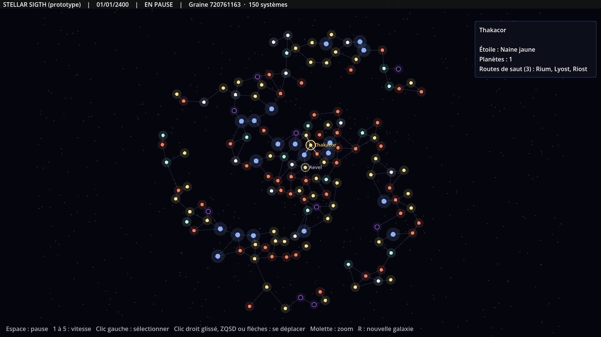

## Lancer le prototype

1. Copier le dossier `stellar-sigth` sur ton PC.
2. Ouvrir Godot 4.7, cliquer sur **Importer**, choisir le fichier `project.godot`.
3. Appuyer sur **F5** (ou le bouton Lecture). Le menu principal s'ouvre : **Nouvelle partie**, choisir son peuple, puis **Lancer la partie**.

## Commandes

| Action | Commande |
| --- | --- |
| Pause / reprise (tour par tour : fin de tour) | Espace, ou le centre du cadran du temps (en bas à droite) |
| Vitesse 1 à 5 | Touches 1 à 5 (rangée du haut ou pavé numérique), ou les crans du cadran |
| Sélectionner un système | Clic gauche (le survol l'affiche dans la fiche en bas à gauche) |
| Lentille économique | L, ou l'onglet « Lentille économique » en haut |
| Ouvrir la vue système | Double-clic sur le système, Entrée, ou bouton « Entrer dans le système » |
| Système suivant / précédent de l'empire | Tab / Maj+Tab sur la carte ; Page préc. / Page suiv. ou les flèches à l'écran dans la vue système |
| Revenir à la capitale | H |
| Planète précédente / suivante (vue système) | Flèches gauche / droite, clic sur la planète ou sa carte en bas |
| Basculer vue orbitale / gestion du système | Tab, ou les onglets en haut au centre |
| Économie, Colonies, Recherche, Diplomatie | F1 à F4, ou les pictogrammes du panneau d'empire |
| Revenir en arrière | Échap : ferme le menu d'empire, puis la vue système, puis désélectionne, puis ouvre le menu du jeu. L'onglet « Vue galaxie » ramène aussi à la carte |
| Se déplacer | Clic droit glissé, molette enfoncée, ZQSD ou flèches |
| Zoomer | Molette (vers le curseur) |
| Sélectionner une flotte | Clic gauche sur son chevron, ou F / Maj+F (flotte suivante / précédente) |
| Envoyer la flotte sélectionnée | Clic droit sur un système (sans glisser) |
| Arrêter, rassembler, détacher, coloniser | Boutons de la fiche de flotte, en bas à gauche |
| Liste des flottes | Panneau à droite sous la chronique : clic = sélectionner et centrer, double-clic = ouvrir le système |
| Flotte inactive suivante | I / Maj+I, ou le bouton « N flottes inactives » au-dessus du cadran |
| Exploration automatique | E (flotte sélectionnée), ou le bouton de la fiche de flotte |
| Tactique de combat de la flotte | T (flotte sélectionnée), ou le bouton « Tactique » de la fiche de flotte |
| Envahir le système assiégé | Bouton « Envahir » de la fiche de flotte (quand les troupes dépassent la garnison) |
| Dernier rapport de bataille | B, ou le bouton « Rapport » de la fiche de flotte |
| Revoir la bataille (vue de replay) | R, ou « Revoir la bataille » dans le rapport ; Espace lecture/pause, Échap revient au rapport |
| Recherche : choisir, lancer, mettre en file, retirer | Écran Recherche (F3) : clic sur une technologie pour sa fiche, double-clic pour la lancer tout de suite ; boutons de la fiche ; croix de la file |
| Diplomatie : proposer un traité, répondre, rompre, déclarer la guerre | Écran Diplomatie (F4) : choisir l'empire sur la table, puis les boutons de la relation (la guerre en deux clics) |
| Victoires : où en est chaque empire | F7, ou le pictogramme étoile du panneau d'empire |
| Renseignement : cellules d'espionnage, réseaux, dossiers, opérations, espions démasqués | F8, ou le pictogramme œil du panneau d'empire |
| Sonde vers un système connu hors de vue | bouton « Sonde » dans la vue du système |
| Diplomatie : unir nos lignées (Ossarane) | Écran Diplomatie (F4), bouton « Unir nos lignées » avec un allié de longue date |
| Construire un vaisseau | « Chantier spatial » dans les ordres d'une colonie, dans la vue système |
| Coloniser, poser un avant-poste, construire | Section « Ordres » de la fiche de la planète, dans la vue système |
| Renommer un système | Bouton « Renommer » à côté de son nom, dans la vue système, puis Entrée |
| Sauvegarde / chargement rapide | F5 / F9, ou le menu du jeu |
| Plein écran | F11, ou Options |
| Spectateur : suivre l'empire suivant / précédent | Tab / Maj+Tab, ou clic sur sa ligne du tableau des empires (double-clic : sa capitale) |
| Spectateur : vue d'ensemble ou yeux de l'empire suivi | V, ou les boutons du tableau des empires |

## Interface et menus

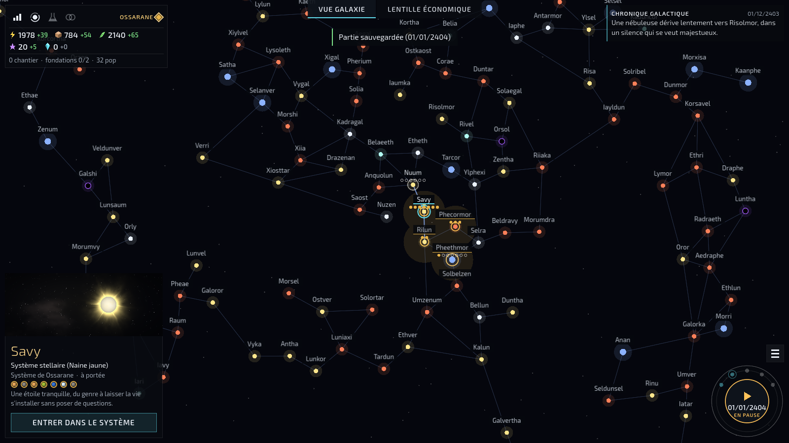

La disposition reprend celle d'Endless Space 2, sans rien lui emprunter (dessins, polices et pictogrammes sont les nôtres) : panneaux plats et translucides aux angles droits, filets fins, police libre Exo 2 en graisses fines, capitales espacées, un seul accent cyan pour la sélection et les actions.

- **Panneau d'empire** en haut à gauche : les pictogrammes des menus d'empire, le nom et l'emblème de votre peuple (son trait en infobulle), les cinq ressources avec leur stock et leur bilan mensuel (détail production, entretien, bonus de faction et délai avant épuisement en infobulle), et une ligne d'état (chantiers, fondations, population, alertes).
- **Onglets de vue** en haut au centre : Vue galaxie, Lentille économique (la carte s'assombrit et seuls vos systèmes restent, avec leur bilan par ressource), et Gestion du système (×) quand un système est ouvert.
- **Fiche de sélection** en bas à gauche : une vignette de l'étoile, le nom, le propriétaire, une pastille par planète (cerclée de la couleur du propriétaire), une ligne d'ambiance et le bouton pour entrer dans le système. Elle montre le système survolé, sinon le système choisi.
- **Cadran du temps** en bas à droite, à la place du bouton de fin de tour : le centre met en pause, la date est dessous, les cinq crans de l'arc règlent la vitesse.
- **Tour par tour au choix** (ligne « Temps » de la nouvelle partie : temps réel pausable, ou tours de 5, 10 ou 30 jours). Au tour par tour, le temps est arrêté pendant qu'on donne ses ordres ; le cadran devient un bouton « Fin de tour » (Espace) qui fait défiler les jours du tour en accéléré, avec la progression sur l'anneau, puis s'arrête au tour suivant. La simulation ne fait aucune différence entre les deux modes (un tour = N ticks ordinaires) : mêmes règles, même déterminisme, et le choix est rangé dans la sauvegarde. En multijoueur, le plan est celui des tours simultanés d'Endless Space 2 : l'hôte lance la fin de tour quand tous les joueurs ont terminé.
- **Étiquettes de systèmes** sur la carte : un cartouche sombre souligné de la couleur du propriétaire, et les pastilles des planètes pour vos systèmes et la sélection.
- **Écrans d'empire** en plein écran, comme dans Endless Space 2 : la carte s'efface derrière un voile, le panneau d'empire et le cadran restent, un onglet en haut au centre nomme l'écran et le ferme, une colonne à gauche résume, et le contenu se range en blocs titrés.
  - **Économie** : bilan des ressources (stock, production, entretien, bilan, tendance), anneau de répartition de la production, production par système (un clic ouvre le système), alertes. La colonne montre votre peuple et ses chiffres clés.
  - **Colonies** : liste filtrable (toutes, colonies, avant-postes, fondations), fiche de la colonie choisie avec son illustration et un bouton pour ouvrir sa vue système (ou double-clic sur la ligne). La colonne fait le compte dans un anneau.
  - **Recherche** : tout l'arbre du peuple (4 domaines × 5 ères), la recherche en cours, le Savoir, la file d'attente et la fiche de la technologie choisie (voir Recherche).
  - **Diplomatie** : la table des statuts, la relation avec l'empire choisi et les propositions reçues (voir Diplomatie).
- **Navigation fluide** : la caméra glisse vers le système choisi (Tab, H), la vue système s'ouvre en fondu, et les flèches de son en-tête passent d'un système de l'empire à l'autre.
- **Chronique galactique** en haut à droite (les six dernières entrées en infobulle). Les notifications (sauvegarde, ordre refusé) apparaissent sous les onglets et s'effacent seules.
- **Menu principal**, sur le modèle de celui d'Endless Space 2 : une grande planète à gauche, les entrées (Continuer ou Reprendre, Nouvelle partie, Options, Quitter) posées le long de son orbite avec un pictogramme rond et une bulle d'aide au survol, l'emblème-titre dans un anneau à droite, sur la galaxie qui dérive.
- **Nouvelle partie**, sur le modèle du choix de faction d'Endless Space 2 : une rangée de portraits (les 4 peuples et « Au hasard »), la grande illustration du peuple choisi à droite, puis ses affinités et traits, son histoire et les réglages de la galaxie (graine facultative : un nombre ou un mot). Boutons ronds Retour et Commencer.
- **Menu du jeu** (Échap) : le temps s'arrête et reprend comme avant à la fermeture. Reprendre, Sauvegarder, Charger, Raccourcis (rangés par thème), Options, Menu principal, Quitter (page de confirmation Annuler / Quitter).
- **Options**, en pleine page comme dans Endless Space 2 : titre centré, onglets (Affichage, Partie, Commandes), une ligne par réglage avec sa valeur dans une case sombre, boutons ronds Retour et Valeurs par défaut dans les coins. Réglages : plein écran, échelle de l'interface (100, 125 ou 150 %), pause automatique dans les écrans d'empire ; l'onglet Commandes liste les raccourcis. Ce sont des réglages du poste (`user://settings.cfg`), jamais enregistrés dans la partie.

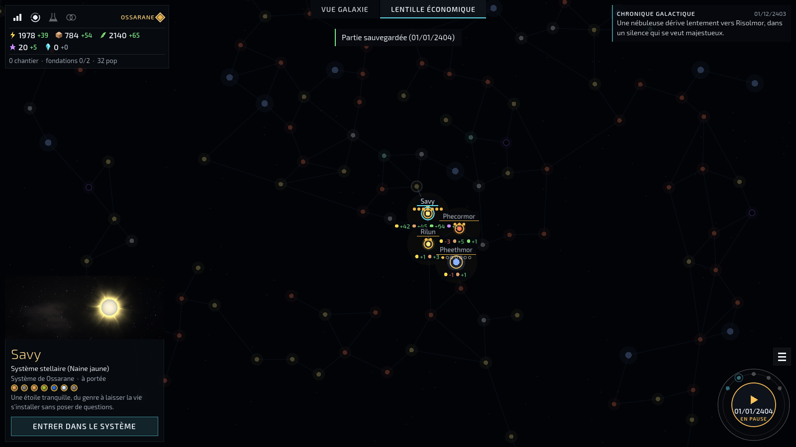
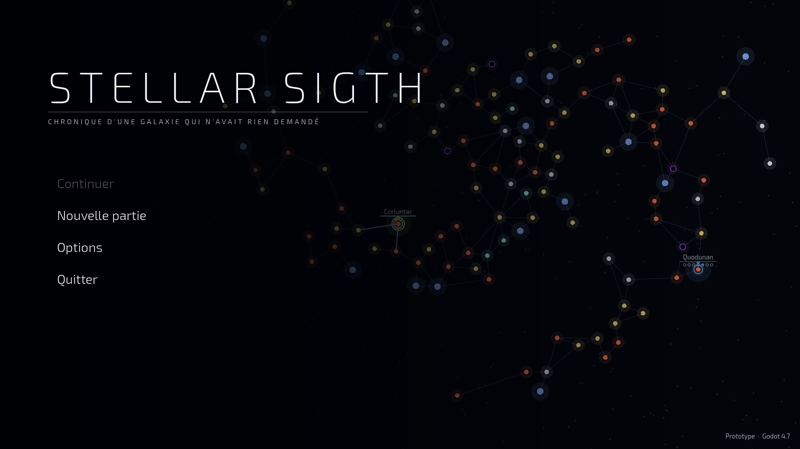
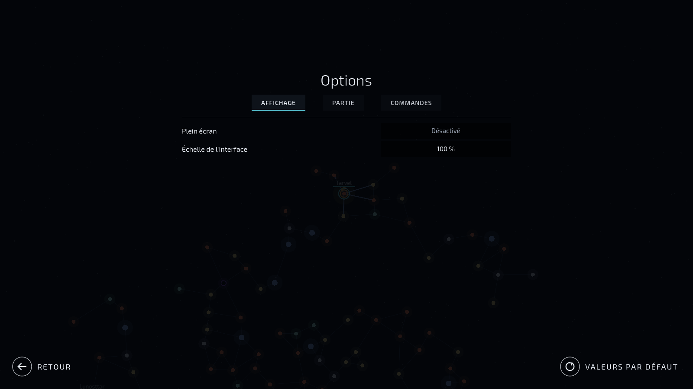
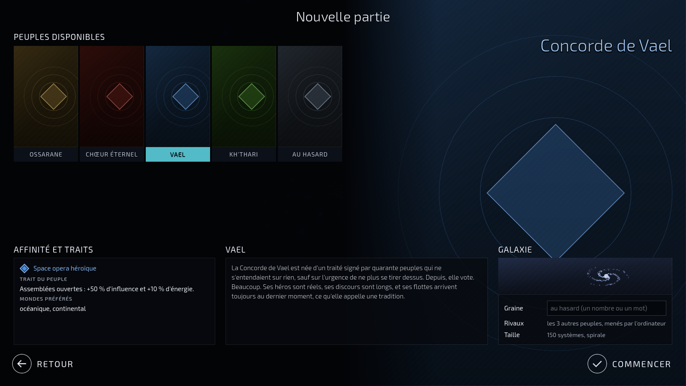
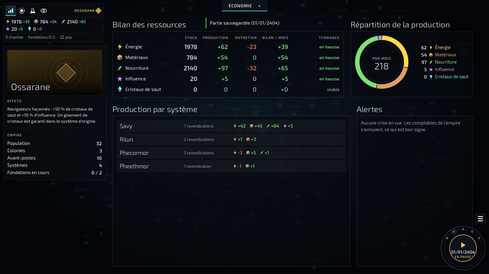
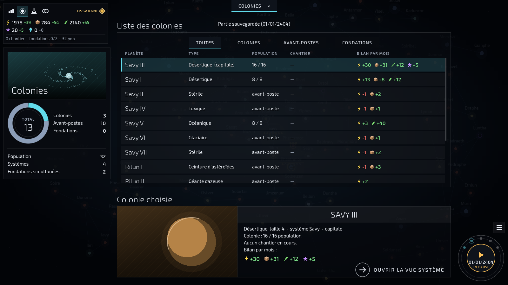

L'interface ne fait que lire la partie et émettre des demandes : les bilans des menus d'empire viennent de `EmpireReport` (côté simulation, en lecture seule, avec les mêmes règles qu'`Economy`), et tout changement passe toujours par un ordre.

### Emplacements d'illustrations

Les portraits de peuples, les bandeaux des écrans d'empire, la planète de la colonie choisie, le bandeau de la galaxie et le fond du menu principal sont des emplacements (`Widgets.ArtSlot`). Tant qu'il n'y a pas d'image, un motif dessiné tient la place dans la bonne teinte. Pour habiller le jeu, il suffira de déposer une image nommée d'après l'emplacement dans `assets/art/` (liste dans [assets/art/LISEZMOI.md](assets/art/LISEZMOI.md)) : aucun code à changer.

Sources d'inspiration étudiées : captures d'Endless Space 2 de la galerie [HUDS+GUIS](https://www.hudsandguis.com/home/2017/7/6/endless-space-2) (écran du Sénat, quêtes, nouvelle partie, choix de faction, choix du gouvernement) ainsi que celles d'[interfaceingame.com](https://interfaceingame.com/games/endless-space-2/) (menu principal, options, menu du jeu, confirmation), et le [guide de l'interface de Gamepressure](https://www.gamepressure.com/endless-space-2/interface-summary/z49c44). Seules la disposition et l'ergonomie s'en inspirent.

## Vue système

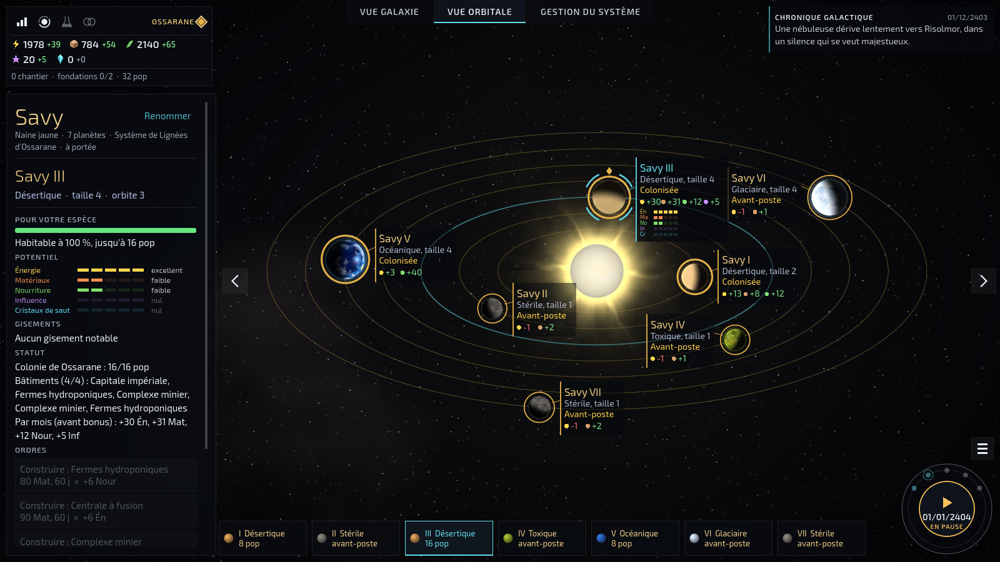

Chaque système a son écran, avec deux vues (onglets en haut au centre, ou Tab) :

- **Vue orbitale** : l'étoile au centre (couronne, faisceaux d'une étoile à neutrons ou disque d'un trou noir), les planètes qui tournent sur leurs orbites, éclairées du côté de l'étoile, et les ceintures d'astéroïdes. Chaque planète porte une fiche accrochée (nom, type et taille, disponibilité : colonisable, avant-poste possible, hors de portée…) ; la planète survolée ou choisie montre aussi son potentiel par ressource. Une colonie est entourée d'un arc de population à la couleur de son empire, un losange marque une capitale. Les fiches de vos planètes établies affichent aussi leur bilan du mois.
- **Gestion** : les planètes alignées en grand pour les comparer d'un coup d'œil, avec leurs rendements par mois (ou leur potentiel si elles ne sont pas à vous), la jauge de population, la disponibilité et l'ordre principal.

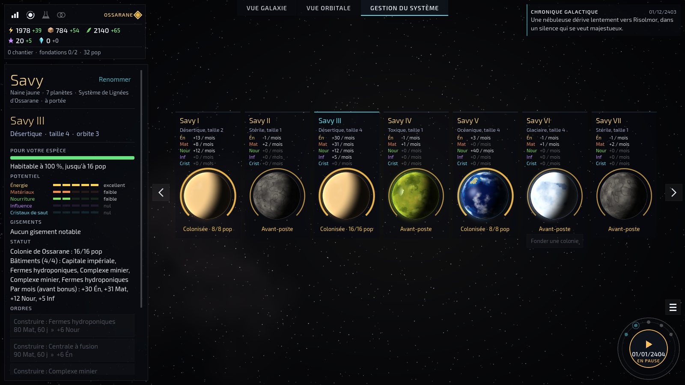

À gauche, sous le panneau d'empire, la colonne du système : son nom (renommable), puis la fiche de la planète choisie : habitabilité pour votre espèce, potentiel, gisements, colonie, bâtiments, production et ordres. Le mouvement des orbites est décoratif et n'influence pas la partie.

Inspiration : les deux niveaux de lecture (vue orbitale avec fiches accrochées, puis vue de gestion avec les planètes côte à côte) viennent de l'étude de captures d'Endless Space 2 ([galerie HUDS+GUIS](https://www.hudsandguis.com/home/2017/7/6/endless-space-2)) ; le rendu et la mise en page restent les nôtres.

La partie démarre en pause, le 01/01/2400, centrée sur le système d'origine du peuple choisi. Les noms des systèmes apparaissent quand on zoome. Un bouton grisé explique pourquoi en survol (ressources, portée…).

## Flottes, déplacements et exploration

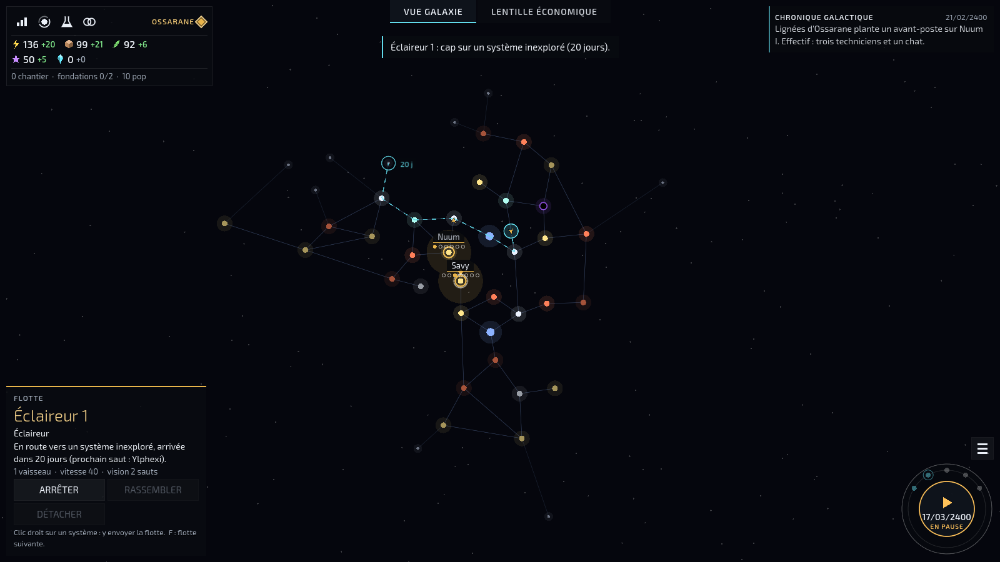

- **Deux classes de vaisseaux pour commencer** (`data/ships.json`) : l'éclaireur (40 Mat, 20 j, rapide, voit à 2 sauts) et le vaisseau colon (100 Mat + 20 Nour, 40 j, lent). Chaque empire démarre avec un de chaque, comme dans Endless Space 2 où l'on commence avec un vaisseau colon. Les vaisseaux de guerre arriveront avec le combat.
- **Chantier spatial** : chaque colonie peuplée construit un vaisseau à la fois, indépendamment de son chantier de bâtiments. Le vaisseau terminé apparaît en orbite dans sa propre flotte (« Éclaireur 2 »). Chaque vaisseau coûte 1 Én d'entretien par mois.
- **Déplacement en temps réel le long des routes de saut** : clic droit sur un système, la flotte prend le plus court chemin connu et avance chaque jour de sa vitesse (celle de son vaisseau le plus lent). Le trajet et le délai s'affichent en pointillés ; le chevron glisse en continu entre deux jours. Une flotte en route peut recevoir un contre-ordre : elle finit sa route ou fait demi-tour, selon ce qui est le plus court (comme dans Stellaris). « Arrêter » la pose au système le plus proche.
- **Ergonomie des flottes** (d'après Endless Space 2) : liste permanente de toutes vos flottes à droite (état : en route, en exploration, attend des ordres, avec délais) ; bouton des flottes inactives au-dessus du cadran, comme celui au-dessus de la fin de tour d'ES2 ; avis à l'arrivée d'une flotte.
- **Exploration automatique** : ordre permanent d'une flotte (sauvegardé, rejouable). Elle vise le système inexploré le plus proche par les routes connues, change de cible dès que la sienne a été vue en chemin, évite celles déjà visées par un autre explorateur, et s'arrête (avec une ligne de chronique) quand il n'y a plus rien à atteindre. Un ordre manuel la coupe.

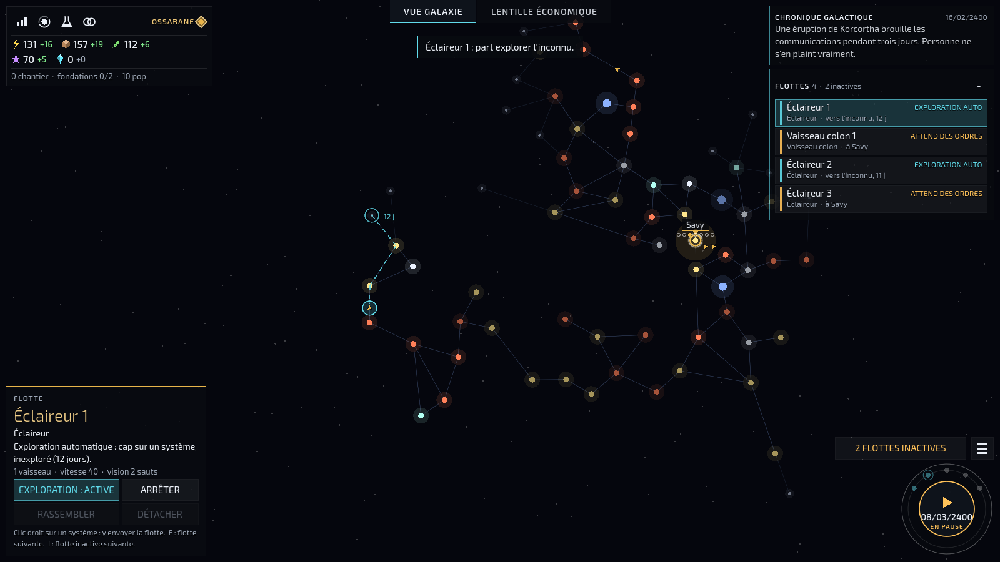

- **Flottes** : « Rassembler » réunit les flottes à l'arrêt dans un même système, « Détacher » en sépare un vaisseau.
- **Brouillard de guerre** : on ne voit que ce qu'observent ses revendications (1 saut autour) et ses flottes (selon leur vision). Un système vu une fois reste exploré (comme la « terra incognita » d'Endless Space 2 que les vaisseaux dissipent pour de bon) ; hors de vue, il est assombri et les flottes étrangères y sont invisibles. Les systèmes reliés à un système exploré apparaissent comme de simples lueurs, sans nom ni planètes : on peut y envoyer une flotte, pas les ouvrir. Le reste de la galaxie et ses routes sont cachés.
- **Dernière information connue** : chaque empire garde un relevé daté de chaque système qu'il a vu (propriétaire, colonies et avant-postes avec leur population, siège, bataille). Hors de vue, la carte, la fiche de sélection, la vue système et la vue de gestion montrent ce relevé, pas l'état réel : un rival qui s'installe au loin n'apparaît qu'au prochain passage. Les couleurs d'un système connu de cette façon sont atténuées, et sa fiche dit « Hors de vue : vu il y a 3 mois (date) ». Les bâtiments et chantiers d'une colonie étrangère hors de vue ne s'affichent pas. Une flotte étrangère aperçue laisse une **silhouette datée** (chevron creux à sa couleur) là où on l'a vue, avec « Flotte aperçue · Vael : 3 vaisseaux armés, aperçu il y a 12 jours » sur la fiche ; elle s'efface quand on revoit l'endroit vide ou au bout de 90 jours. Les **alliés partagent leur vision en direct** (ce que voit l'un, l'autre le voit aussi, et sa mémoire se met à jour), et leurs relevés chaque mois (le plus récent l'emporte). Le spectateur voit l'état réel ; avec les « yeux de l'empire », il voit la mémoire de l'empire suivi. Inspiration : la carte privée par joueur de Freeciv et les niveaux d'intel de Stellaris ([étude](https://claude.ai/artifact/52fxA23vepYqQ5951rRkHq)). Sauvegarde en version 16 (relevés et silhouettes) ; une sauvegarde 15 se reprend avec une mémoire tirée de l'état réel. L'IA a les mêmes yeux : hors de vue, elle juge les systèmes (libres ou pris, frontières, force d'un rival, cible de guerre) sur sa propre mémoire, et estime les garnisons d'après son relevé (population et avant-postes, sans bâtiments ni capitale). Un rival qui s'installe en douce la surprend, comme le joueur. Sur les bancs (5 niveaux, graines 3, 17 et 99), l'ordre des niveaux tient et aucun ne s'effondre : pas de bonus de vision.

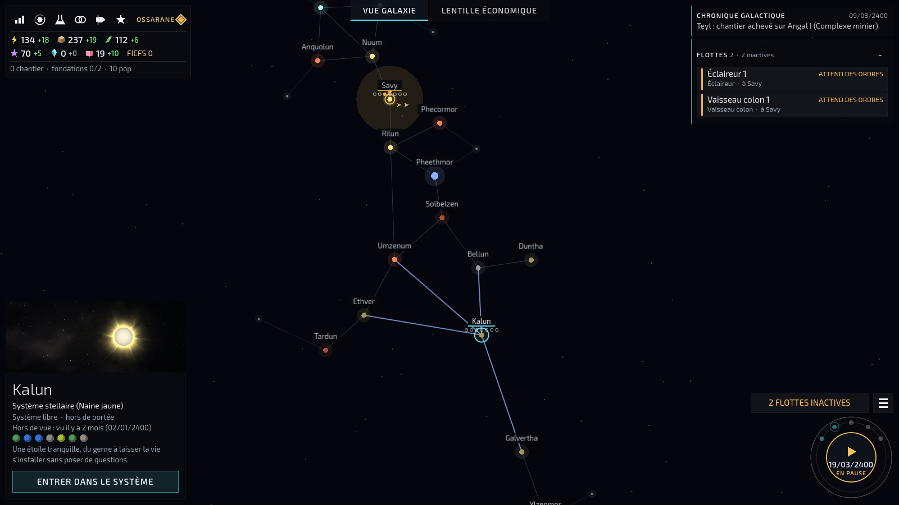

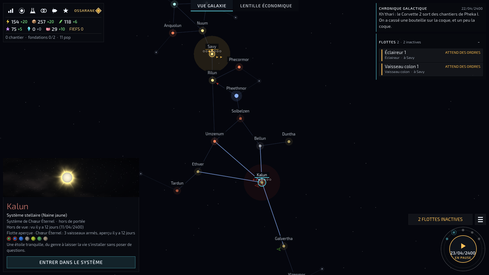

- **Colonisation par vaisseau colon** : pour s'installer dans un nouveau système, il faut y amener un vaisseau colon, qui se démonte pour fonder l'avant-poste ou la colonie (il ne reste à payer que l'influence). Une fois une revendication établie dans un système, ses autres planètes se revendiquent sans vaisseau, comme avant. La règle provisoire « système voisin » disparaît.
- **Premier contact** : quand un empire aperçoit un système ou une flotte d'un autre, la chronique raconte la rencontre et les deux empires la retiennent (base de la future diplomatie).
- **Tout passe par des ordres** (`build_ship`, `move_fleet`, `stop_fleet`, `merge_fleets`, `split_fleet`), en nombres entiers et sans aléatoire. Sauvegarde en version 3 (flottes, systèmes explorés, contacts, chantiers spatiaux).

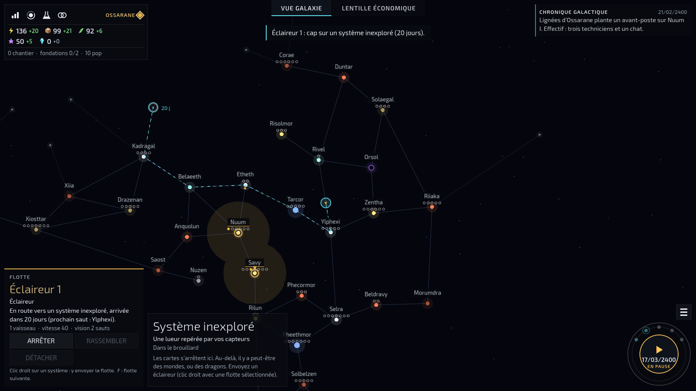
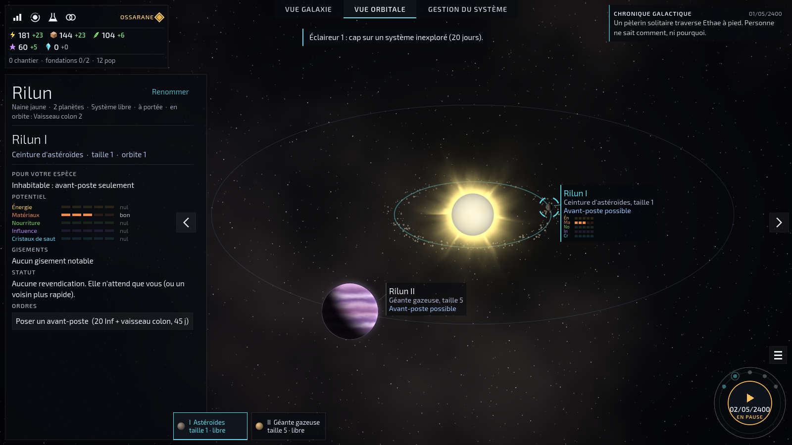

Références consultées pour ces mécaniques : Endless Space 2 reste le modèle principal ([déplacements et routes](https://gamepressure.com/endless-space-2/systems-and-ways-of-travelling/z29c4b), [colonisation par vaisseau colon et avant-poste](https://www.gamepressure.com/endless-space-2/colonization-migration-and-evacuation/z69c4f)), complété par d'autres 4X en temps réel : Stellaris pour les contre-ordres en plein trajet et l'exploration par vaisseaux scientifiques, Sins of a Solar Empire pour garder des trajets courts (ses joueurs se plaignent d'attendre plusieurs minutes une flotte, [discussion Steam](https://steamcommunity.com/app/1575940/discussions/1/651441204180820081)).

## Les 8 peuples et leurs traits

Chaque peuple de la première version a des traits qui changent vraiment la façon de jouer (économie, flottes, colonisation). Ils sont décrits en entier dans l'écran Nouvelle partie, rappelés en infobulle sur le nom du peuple, et chaque peuple a sa jauge dans le panneau d'empire. Tous les réglages sont dans `data/factions.json`.

| Peuple | Traits | Ce que ça change |
|---|---|---|
| **Lignées d'Ossarane** (médiéval spatial) | Navigateurs façonnés, Serment des fiefs, Fils de Saphène | Flottes 30 % plus rapides et monopole des cristaux. Chaque colonie hors du système capital est un fief qui verse +1 influence ; un fief à plus de 4 sauts coûte 1 cristal par mois, et sans cristaux les fiefs lointains entrent en dissidence (production divisée par deux). On s'étend vite, mais on doit tenir ses routes de cristaux. |
| **Hégémonie du Chœur Éternel** (grimdark) | Forges sacrées, Le dieu-machine a faim, Offrande, Pèlerins zélés | La ferveur (0 à 100) baisse de 5 par mois et monte de 1 par colonie. À 60 ou plus, Exaltation : +25 % de production ; à 0, le dieu se tait : -25 %. Ordre « Offrande » : -1 population, +20 ferveur. Les nouvelles colonies démarrent à 2 population. On s'étend pour nourrir le dieu, ou on sacrifie. |
| **Concorde de Vael** (space opera héroïque) | Assemblées ouvertes, Quarante peuples, Vote d'urgence, Ambassades | Toute planète habitable l'est au moins à 60 %. Ordre « Vote d'urgence » : achever tout de suite un bâtiment ou un vaisseau contre de l'influence (1 pour 2 jours restants). +2 influence par mois par empire rencontré. L'influence devient une monnaie. |
| **Essaim Kh'thari** (horreur biologique) | Croissance explosive, Essaimage, Biomasse | Pas de vaisseau colon : des vaisseaux-spores payés en population (2) et en nourriture. Coloniser ne coûte jamais d'influence. Une colonie pleine continue de grandir et digère chaque population en trop en 15 matériaux. On produit des colons, pas des diplomates. |
| **Noosphères de Teyl** (classique / hard SF) | Chaînes d'assemblage, Courant vital, Réseau de nœuds, Érudits | Synthétiques : chaque habitant est assemblé pour 12 matériaux, l'énergie remplace la nourriture, les mondes toxiques sont habitables à 60 %. +5 % de Savoir par colonie reliée à la capitale (50 % au plus) ; une revendication coupée du réseau par l'ennemi produit moitié moins. +20 % de Savoir, +25 % de matériaux, gisement géothermique chez soi. Ajouté avec l'éditeur d'espèces (lot 3) : ses règles sont exactement celles de ses briques. |
| **Clans Ferrocornes** (grimdark, reptiliens nomades) | Sang-froid, Transhumance, Flotte-ville, Campement, Le clan suit la flotte, Pillage, Canonniers, Garnisons tenaces, Filons du berceau | Pas de planète capitale : la capitale est une flotte-ville armée qui se déplace, et le clan ne disparaît pas tant qu'elle vogue. Le système où elle campe produit 50 % de plus, les revendications à plus de 4 sauts 30 % de moins. En guerre, chaque vaisseau armé à l'arrêt chez l'ennemi pille ses réserves. Habitants qui mangent 30 % de moins, mondes glaciaires inhabitables, colonies pleines qui essaiment vers les moins peuplées. Dégâts +10 %, garnisons +50 %. Ajouté avec l'éditeur d'espèces (lot 3) : ses règles sont exactement celles de ses briques. |
| **Syndicat Brisecomète** (picaresque, multi-espèces) | Réputation, On s'y attendait, Flottes à louer, Comptoirs, Pas de racines, Flotte de départ, Quarante peuples, Navigateurs, Canonniers, Partis de rien | Une réputation de 0 à 100 nourrie par l'espionnage, les contrats et les coups d'éclat : elle rapporte de l'énergie, renchérit les flottes louées et facilite les intrigues. Flottes à louer aux empires en guerre, avant-postes-comptoirs (+2 énergie), vraies colonies deux fois plus chères. Espionnage industriel (credo Profit) : une cellule de plus, larcins à moitié prix, dividendes chez les partenaires. Planètes habitables à 60 % au moins, flottes 30 % plus rapides, dégâts +10 %. Ajouté avec l'éditeur d'espèces (lot 3) : ses règles sont exactement celles de ses briques. |
| **Murmurants d'Abysse** (cosmique, énergétiques) | Échos, Préscience, Le Voile, Corps immatériels, Ni air ni sol, Le dieu a faim, Offrande, Croisade, Assemblées ouvertes, Érudits, Pèlerins zélés, Casaniers, Veine de cristaux | Invisibles : leurs flottes et leurs revendications n'apparaissent pas aux autres empires, sauf avec la technologie Détecteurs d'abysse, à leurs alliés, aux autres peuples voilés et à qui se tient dans le même système. Ils ne mangent pas, mais croissent 25 % moins vite et tiennent mal le terrain (garnisons moitié moins nombreuses) ; les mondes stériles leur sont habitables à 50 %. Les échos (2 par mois, plus 1 par colonie) replient le temps : 30 échos avancent un chantier de 60 jours. Les flottes qui viennent vers eux se voient dès leur départ. Ferveur de théocratie, Académies (raison), influence +50 %, Savoir +20 %, flottes 20 % plus lentes. Ajouté avec l'éditeur d'espèces (lot 3) : ses règles sont exactement celles de ses briques. |

Nouveaux ordres : `sacrifice` (Chœur) et `rush` (Vael). Sauvegarde en version 4 (ferveur, dissidence, biomasse), puis 5 avec le niveau des IA, puis 6 avec le combat.

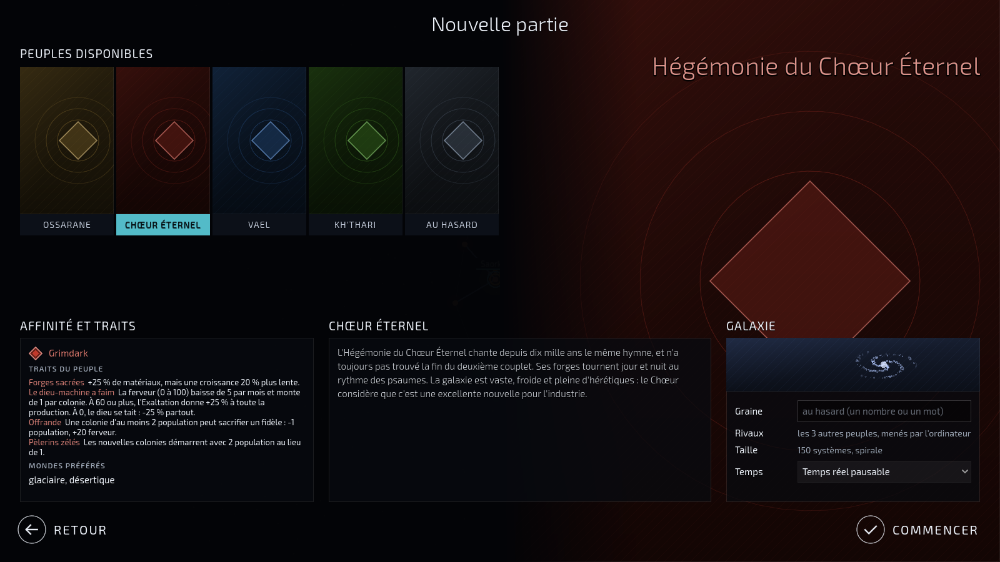
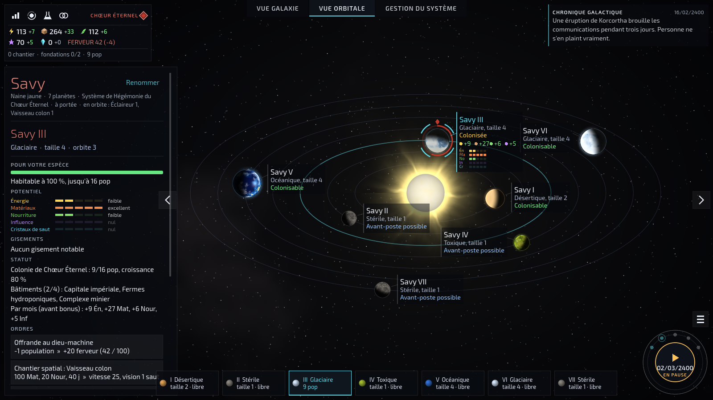

Références consultées pour ces mécaniques (les traits restent originaux) : les guides Gamepressure d'Endless Space 2 sur [le choix de la race](https://www.gamepressure.com/endless-space-2/what-race-should-i-choose/z09d03) (les Unfallen sacrifient leur population contre de l'approbation, les Cravers doublent leur croissance, les Lumeris n'ont pas de vaisseau colon) et sur [l'Empire Uni](https://www.gamepressure.com/endless-space-2/united-empire/za9ce9) (l'influence sert à accélérer les constructions), et les discussions des développeurs de Stellaris sur [l'essaim dévoreur](https://admin-forum.paradoxplaza.com/forum/developer-diary/stellaris-dev-diary-76-hive-mind-improvements-tradition-swapping.1034124) (une ruche privée de diplomatie).

## Empires IA et mode spectateur

Les trois autres peuples sont menés par l'ordinateur : ils explorent, colonisent, construisent et se servent des talents de leur peuple. Le niveau et le tempérament se choisissent dans la ligne « Rivaux » de la nouvelle partie (réglages dans `data/ai.json`).

| Niveau | Comment il joue | Bonus |
|---|---|---|
| **Recrue** | Réfléchit tous les 20 jours, oublie une décision sur trois, se sert très mal des talents de son peuple, une seule colonisation à la fois | aucun |
| **Normal** (par défaut) | Tous les 10 jours, quelques oublis, connaît les bases de son peuple ; quand ses matériaux s'entassent (500), il construit des forums pour l'influence | aucun |
| **Vétéran** | Tous les 5 jours, aucun oubli, exploite tout le registre de son peuple et lit son goulot plus tôt (forums dès 250 matériaux en réserve) | aucun |
| **Expert** | Le jeu du Vétéran | +15 % de production, petite avance au départ |
| **Légende** | Le jeu du Vétéran, plus réactif encore | +30 % de production, vraie avance au départ |

Ce que chaque peuple fait de ses talents selon le niveau (bloc `"ai"` de `data/factions.json`) :

- **À la Recrue**, chaque peuple connaît ses talents mais les gâche : le Chœur attend que son dieu se taise et sacrifie dans sa plus petite colonie ; Vael vote l'urgence sur des chantiers presque finis, au prix plancher, sans garder d'influence pour coloniser ; Ossarane court après les cristaux sans compter ce que coûtent ses fiefs lointains ; l'Essaim lance ses spores depuis ses colonies les plus fragiles.

- **Ossarane** : garde ses premiers fiefs à portée de la capitale et ne pose de fief lointain que s'il produit les cristaux pour le payer (au Vétéran, le compte est exact) ; raffinerie sur chaque gisement de cristaux.
- **Chœur Éternel** : offrande quand le dieu va se taire (Normal) ; au Vétéran, entretient l'Exaltation (+25 %) en prenant le fidèle dans une colonie pleine, qui regrandit sans rien perdre.
- **Vael** : vote d'urgence sur les vaisseaux colons et les longs chantiers dès que l'influence déborde (au Vétéran, dès qu'il reste de quoi payer la prochaine revendication) ; un éclaireur de plus pour rencontrer les autres empires (ambassades).
- **Kh'thari** : vaisseaux-spores lancés depuis ses colonies les plus peuplées (pleines d'abord au Vétéran, la biomasse fait le reste), colonisation sans compter l'influence, fermes en priorité.

**Tempérament.** À côté du niveau, un second réglage règle l'attitude des IA envers les autres empires, sans jamais changer leurs ressources : Pacifique, Prudent, Normal, Agressif, Belliqueux (`data/ai.json`). Chaque peuple le décale d'un cran (bloc `"ai"."temperament"`) : Ossarane est fière (sans décalage), le Chœur zélé et l'Essaim vorace (un cran plus agressifs ; l'Essaim ne fera jamais la paix), Vael conciliante (un cran plus pacifique). Il oriente l'expansion : un empire agressif colonise au contact de ses rivaux et se jette sur les systèmes disputés, un empire pacifique garde ses distances (seules comptent les frontières qu'il a explorées). La même valeur (`AiLevels.aggression`) décide des guerres (voir Combat spatial) et décidera des traités. Inspiré de l'agressivité des IA de Stellaris ([Gameranx](https://gameranx.com/updates/id/55918/article/stellaris-beta-patch-1-10-adds-ai-aggressiveness-customized-titles-and-more/)), des traits de personnalité des IA d'Endless Space 2 et de la guerre éternelle des Cravers ([forum Amplitude](https://community.amplitude-studios.com/amplitude-studios/endless-space-2/ideas/227-faction-goals)), et des programmes des dirigeants de Civilization VI ([PCGamesN](https://www.pcgamesn.com/civilization-vi/leaders-agendas)).

Sur 3 galaxies et 5 ans entre IA (`tools/ai_bench.gd`), le score moyen monte bien avec le niveau pour chaque peuple, et une IA Légende finit devant les autres dans les parties mixtes.

**Comment c'est fait.** L'IA fait partie de la simulation (`AiSystem`, appelé à la fin de chaque tick, et le cerveau `AiPlayer`) : elle ne voit que ce que son empire a exploré et n'agit que par les ordres ordinaires (`SimCommands`), validés comme ceux d'un joueur. Ses « oublis » viennent d'un hachage de la graine et du jour, jamais de l'aléatoire global : elle joue exactement pareil en temps réel et au tour par tour, dans une rediffusion (le journal ne garde que les ordres des joueurs, les IA se rejouent seules) et sur toutes les machines d'une partie en réseau. Le module `_military` mène la guerre (voir Combat spatial) ; `_diplomacy` négocie (voir Diplomatie).

**Mode spectateur.** Ligne « Partie » de la nouvelle partie : « Spectateur ». Les 4 peuples sont des IA et personne ne donne d'ordre. La carte est entièrement visible, et le **tableau des empires** remplace la liste des flottes : classement au score, niveau, systèmes, colonies, population, flottes, jauge du peuple, ce que fait chaque IA en ce moment, et la courbe du score de chacun mois après mois. Clic sur une ligne (ou Tab) : suivre l'empire (panneau d'empire, H pour sa capitale) ; double-clic : sa capitale. V ou les deux boutons : vue d'ensemble, ou les **yeux de l'empire** suivi (son brouillard de guerre). La vue système reste consultable, en lecture seule. Une sauvegarde d'une partie sans joueur se recharge en spectateur. Ce même mode servira aux spectateurs d'une partie en réseau (un client sans empire).

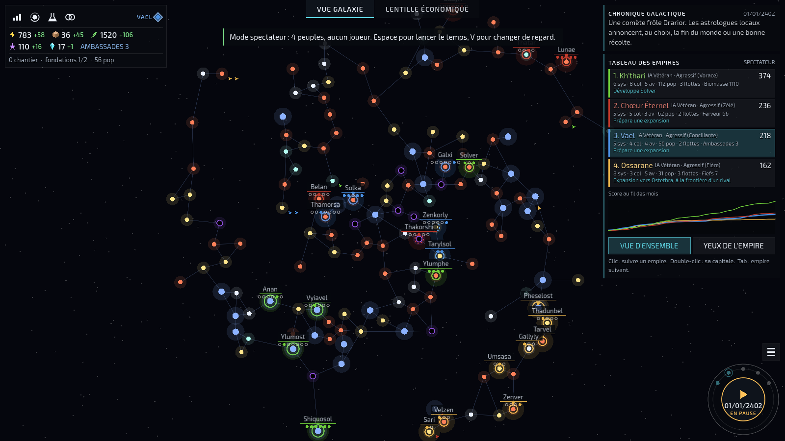
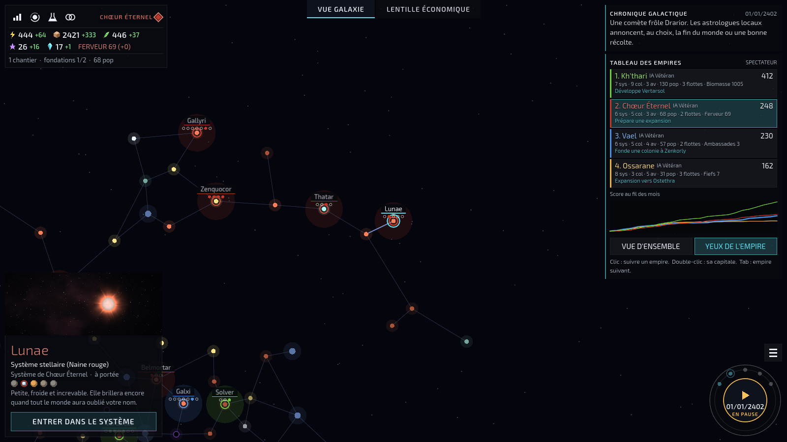

Recherche consultée (le reste vient de mémoire et est signalé comme tel dans la PR) :
- Endless Space 2 : [discussion Steam « What does upping the difficulty do to the AI? »](https://steamcommunity.com/app/392110/discussions/0/1291817837615803045/) (propos rapportés de l'équipe : l'IA reçoit des bonus à partir de Difficile ; en dessous, elle réagit moins aux menaces, poursuit ses objectifs plus lentement et négocie moins bien ; son seul avantage est un bonus de production) ; [fil sur les outils de débogage E.N.F.E.R.](https://community.amplitude-studios.com/amplitude-studios/endless-space-2/forums/65-general/threads/24821-enfer-ai-debug-tools?page=-7) (IA à base d'objectifs et de tâches dotés d'une « motivation » qui plafonne les ressources engagées ; outil désactivé en multijoueur parce qu'il montre les informations des adversaires) ; [fil Steam sur l'IA](https://steamcommunity.com/app/392110/discussions/0/3111396383970684094) (l'IA utilise les mêmes mécaniques que le joueur). Aucune trace d'un mode spectateur dans Endless Space 2 ; une [suggestion de joueurs pour le premier Endless Space](https://community.amplitude-studios.com/amplitude-studios/endless-space/forums/29-archives/threads/13521-composite-suggestion-timed-peace-and-replays-spectating?page=1) le réclamait déjà.
- Galactic Civilizations : [journal de développement « Organic Difficulty »](https://forums.sorcererking.com/537257/galciv-iv-dev-journal-106-organic-difficulty-in-galciv-iv) et [notes de la v3.3](https://forums.sinsofasolarempire2.com/541281/galactic-civilizations-iv-v3-3-now-available) (IA adaptative), [wiki](https://galciv.fandom.com/wiki/Difficulty_level) (difficulté réglable empire par empire).
- Stellaris : commande `observe` pour regarder la partie ([PCGamesN](https://www.pcgamesn.com/stellaris/cheats-console-commands)).
- Age of Empires II DE : spectateurs qui passent d'un joueur à l'autre avec un bandeau d'informations ([Wikipédia](https://en.wikipedia.org/wiki/Age_of_Empires_II:_Definitive_Edition)), et l'outil [CaptureAge](https://captureage.com/docs) (statistiques et événements pour les spectateurs).

## Combat spatial

Les flottes d'empires en guerre se battent quand elles se retrouvent dans le même système, les systèmes ennemis se prennent par le siège puis l'invasion, et l'IA s'en sert selon son niveau et son tempérament. Tout est réglé dans `data/combat.json`, `data/ships.json` (vaisseaux) et les blocs `"combat"` de `data/factions.json`.

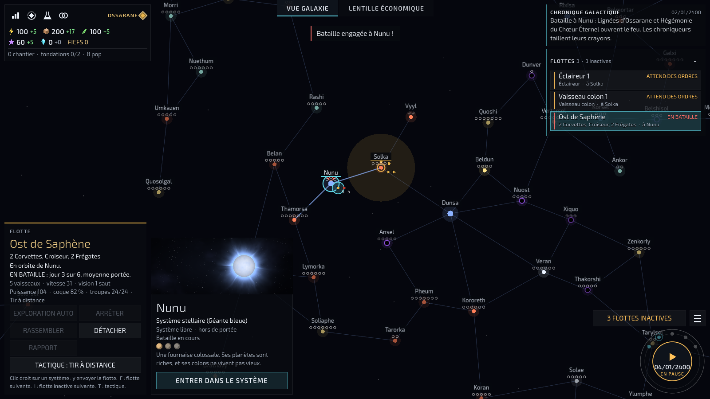
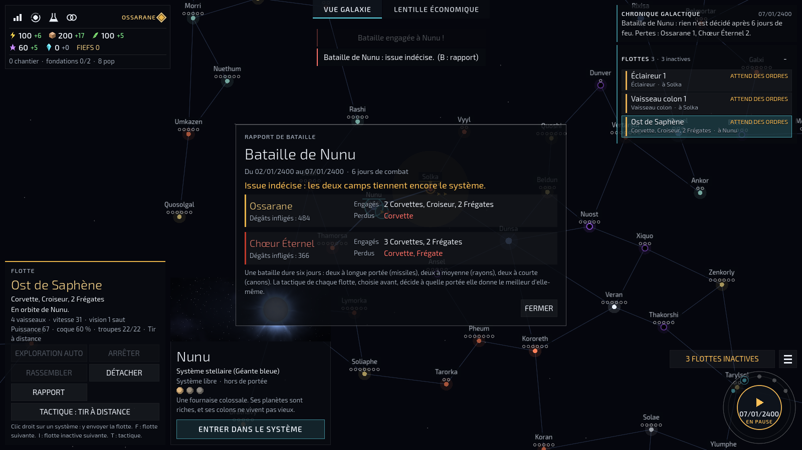
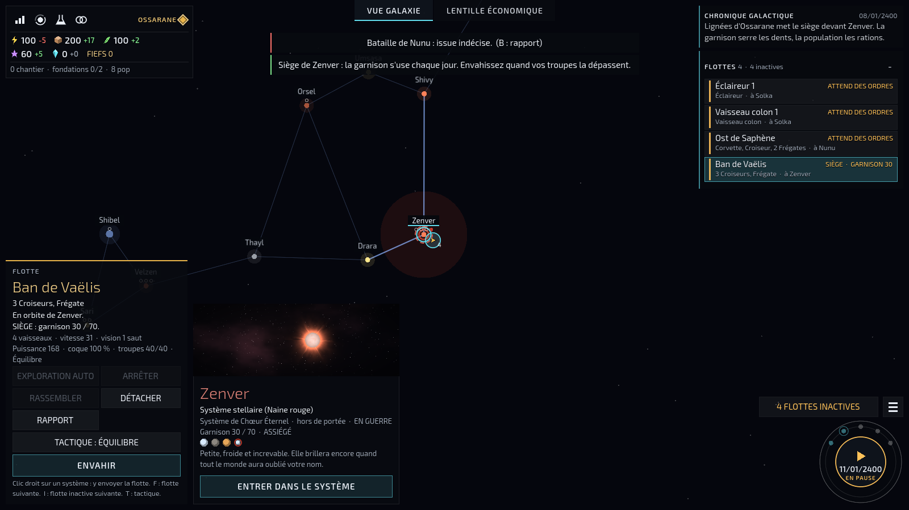
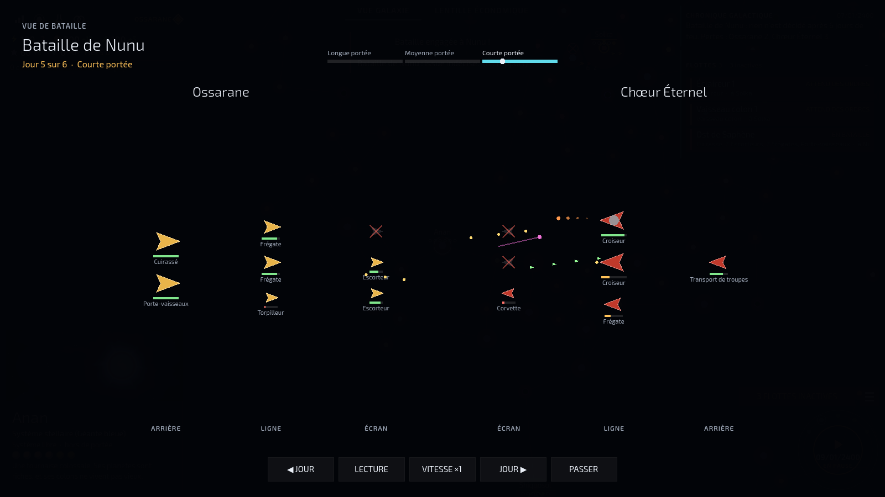

- **La guerre.** Les empires se déclarent la guerre depuis l'écran Diplomatie (F4), une fois rencontrés ; elle vaut dans les deux sens. L'Essaim Kh'thari chasse une proie à la fois : sans guerre, il attaque le premier empire rencontré, puis, sa proie digérée, le plus proche (chaque mois). La paix se négocie (voir Diplomatie).
- **Un catalogue de vaisseaux de guerre** (voir « Catalogue de vaisseaux » plus bas) : la **corvette** (rapide, canons cinétiques, mortelle au contact), la **frégate** (rayons à moyenne portée, boucliers), le **croiseur** (missiles à longue portée, blindage, 12 troupes pour les invasions), et neuf autres classes. Éclaireurs et vaisseaux colons ne sont pas armés : ils subissent.
- **La bataille** est automatique et dure six jours : deux à longue portée, deux à moyenne, deux à courte. Chaque famille d'armes a sa portée (missiles 90/70/40 %, rayons 50/90/70 %, canons 20/40/90 %), les boucliers réduisent les rayons, le blindage les canons et les missiles. Tous les vaisseaux tirent chaque jour sur une cible au hasard (tirée par la simulation, donc identique sur toutes les machines), les dégâts s'appliquent ensemble. Au bout des six jours, un rapport est rédigé (B) ; si les deux camps sont encore là, une nouvelle bataille commence. Les flottes qui arrivent en cours de route rejoignent la bataille.
- **La vue de replay** (facultative) : la simulation garde le journal de chaque bataille (qui tire sur qui, avec quelle arme, pour combien, et qui est détruit, jour par jour), et « Revoir la bataille » dans le rapport le rejoue en 2D stylisée : chaque camp rangé en écran, ligne et arrière, les tirs dessinés par famille d'armes (missiles en courbe, rayons, traçantes, torpilles, obus, essaims de chasseurs), les coques qui baissent, les vaisseaux qui sautent. Lecture, pause, vitesse ×1/×2/×4, jour par jour. Elle ne fait que relire ce qui s'est passé : la partie continue pendant ce temps (en multijoueur, chacun regarde quand il veut), comme les batailles qu'on peut regarder ou passer dans Endless Space 2. Une version plus cinématique viendra avec le passage en 2,5D.
- **La tactique** se choisit avant (T), comme les plans de bataille d'Endless Space 2 : Équilibre, Assaut (charge, pour les corvettes), Tir à distance (pour les missiles), Rempart (-20 % de dégâts reçus). On ne contrôle rien pendant la bataille, mais on peut **sonner la retraite** : l'ordre de déplacement s'applique avant la reprise du lendemain.
- **Le blocus.** Une flotte armée ennemie arrête toute flotte qui traverse son système.
- **Le siège.** Une flotte armée dans un système ennemi sans défenseur le met en siège : sa garnison fond chaque jour (corvette et frégate 1, croiseur 3), sa production tombe de moitié, ses chantiers spatiaux s'arrêtent. Le **bastion orbital** (nouveau bâtiment) ajoute 20 de garnison et tire chaque jour sur les assiégeants tant que la garnison tient. La garnison dépend de la population (5 par population, 6 par avant-poste, 30 pour la capitale) et remonte de 2 par jour une fois le siège levé.
- **L'invasion.** Quand les troupes embarquées dépassent la garnison, « Envahir » : toutes les revendications de l'empire dans le système changent de mains. Une capitale perdue est remplacée par la colonie la plus peuplée ; un empire sans revendication disparaît, avec ses flottes.
- **Réparations et troupes** : vite dans ses propres systèmes (5 % de la coque par jour), lentement ailleurs (1 %) ; les troupes se refont chez soi.
- **Temps réel et tour par tour** : la simulation ne fait aucune différence. Au tour par tour, le tour s'interrompt quand une bataille s'engage avec vos flottes, pour choisir la tactique ou se retirer ; « Fin de tour » joue le reste du tour.

**Les traits de peuple au combat** (en attente depuis les factions) :

| Peuple | Trait | Effet |
|---|---|---|
| Ossarane | Ban des vassaux | +15 % de dégâts dans ses propres systèmes, garnisons des fiefs +50 % |
| Chœur Éternel | Croisade | +2 ferveur par vaisseau ennemi détruit, +10 par système conquis |
| Vael | Au dernier moment | Une flotte qui rejoint une bataille déjà engagée inflige +30 % de dégâts |
| Kh'thari | Faim sans traité | Toujours en guerre avec une proie (le premier empire rencontré, puis le plus proche) ; colonies conquises digérées (il reste 1 population, le reste devient 15 matériaux par population) ; coques vivantes qui se réparent partout ; garnisons +50 % |

Les héros de Vael et la trahison d'héritier d'Ossarane attendront les personnages.

**L'IA au combat** (bloc `"military"` de chaque niveau et `"war"` de `data/ai.json`) :

- **Le tempérament décide de la guerre.** Passé un délai de grâce d'un an, une IA déclare la guerre à un voisin si elle se juge assez forte : il lui faut 3 fois la force estimée de l'autre au tempérament Normal, 1,5 fois en Agressif, autant que lui en Belliqueux, 0,8 fois au plus agressif ; un Pacifique ou un Prudent ne déclare jamais (il se défend et contre-attaque). Plus il est agressif, plus il va chercher loin, et seuls les plus belliqueux ouvrent un second front. Il arme aussi plus ou moins.
- **Le niveau décide du savoir-faire.** La Recrue arme, attaque et choisit sa tactique, mais mal : toujours à l'assaut (même avec des missiles), des vaisseaux au hasard, ses flottes envoyées une par une, jamais de retraite, et elle ne compte que les flottes qu'elle voit. Le Normal rassemble ses flottes, attend d'être plus fort que la cible, se retire quand il est dominé et fortifie le front (bastions). Le Vétéran et au-dessus adaptent la tactique aux armes de chaque flotte, construisent ce qui contre la flotte ennemie qu'ils voient et des croiseurs quand les troupes manquent.
- **Face à l'Essaim.** Un empire qui a un Essaim en chasse à moins de 3 sauts arme une fois et demie plus, sans attendre d'être sa proie ; et dès que l'Essaim a conquis un premier système et tient au moins 25 % de systèmes de plus que lui, il entre en guerre contre lui sans compter les forces, même s'il a déjà un front (sauf les Pacifiques et la Recrue).
- Toutes les IA défendent leurs systèmes assiégés, assiègent la cible la plus faible, envahissent dès que leurs troupes suffisent, et ne voient que ce que leur empire voit. Elles agissent toujours par les ordres ordinaires.

**Équilibre de l'Essaim** (`tools/balance_bench.gd` puis `tools/balance_report.py`, 24 galaxies, 25 ans, IA Normales). Avant, en guerre avec tous dès le premier contact, il mourait dans 14 parties sur 24 (10 fois avant l'an 10) et gagnait les 5 autres fois qu'il survivait assez longtemps (Moisson à l'an 15, immédiate). Avec la proie unique, la coalition et la Moisson à tenir deux ans : 5 victoires (conquête aux ans 3, 6 et 13, Moisson aux ans 17 et 20), 10 parties où il survit sans gagner, 9 disparitions dont 3 avant l'an 10. Contrepartie : ses premières proies (le Chœur, Ossarane) disparaissent plus souvent tôt.

Sur 3 galaxies et 8 ans entre IA Normales (`tools/war_bench.gd`), il y a une centaine de batailles et de sièges par partie, et un empire disparaît souvent vers la troisième année ; au tempérament Pacifique, seul l'Essaim est en guerre.

**Recherche consultée** (la règle du projet : ce qui vient de sources est cité, le reste est signalé comme venant de mémoire) :
- Endless Space 2 : [guide Gamepressure des batailles spatiales](https://www.gamepressure.com/endless-space-2/space-battles/z39cd3) (blocus puis attaque, tactique choisie avant la bataille, aucun contrôle pendant), [GDD 4 « Battle overview » d'Amplitude](https://community.amplitude-studios.com/amplitude-studios/endless-space-2/forums/65-general/threads/18857-es2-gdd-4-battle-overview?page=1) (arrivée, trois phases, résolution ; plan de bataille choisi au début ; renforts ; même résultat en bataille automatique), [guide des armées et batailles au sol](https://www.gamepressure.com/endless-space-2/armies-and-ground-battles/z49cd4) (le siège réduit la garnison chaque tour, puis invasion), [GDD 14 « Ground battle »](https://community.amplitude-studios.com/amplitude-studios/endless-space-2/forums/65-general/threads/19715-es2-gdd-14-ground-battle?page=1) (blocus pour affaiblir le système avant l'invasion, conséquences économiques des guerres), [guide de la main-d'œuvre](https://www.gamepressure.com/endless-space-2/manpower/z99c49) (les équipages servent de troupes, réapprovisionnement coupé par le blocus) et [des discussions de joueurs sur le forum d'Endless Space 2](https://community.amplitude-studios.com/amplitude-studios/endless-space-2/forums/66-game-design/threads/28821-defence-mechanics-explanations-issues?page=2) (les boucliers absorbent surtout les armes à énergie, le blindage surtout les cinétiques et les missiles ; les chiffres varient selon les versions, je n'ai pas trouvé de source officielle).
- Endless Space (le premier) : [guide Gamepressure du combat](https://www.gamepressure.com/endless-space/battle/z33e65) (efficacité des armes par phase : missiles 90/70/40 %, rayons 50/90/70 %, cinétiques 20/40/90 %, reprise telle quelle).
- Stellaris : [journal de développement 99 sur les armées](https://admin-forum.paradoxplaza.com/forum/developer-diary/dev-diary-99-ground-combat-army-rework.1061707/page-17) et [guide de la conquête](https://gamerempire.net/stellaris-how-to-conquer-a-planet/) (bombardement qui use les défenses, forteresses) : pour le bastion qui tient tant que la garnison tient.
- De mémoire (non vérifié) : la durée de six jours, les chiffres des vaisseaux et des garnisons, les traits de combat des peuples et le comportement de l'IA sont des choix maison.

## Diplomatie

Les empires qui se rencontrent entrent en **guerre froide**, puis peuvent signer la paix, s'allier, commercer, échanger leurs cartes, se trahir ou se faire la guerre. Tout est réglé dans `data/diplomacy.json` ; les règles vivent dans `scripts/sim/diplomacy.gd`, le jugement et les initiatives de l'IA dans `scripts/sim/ai/ai_diplomacy.gd`.

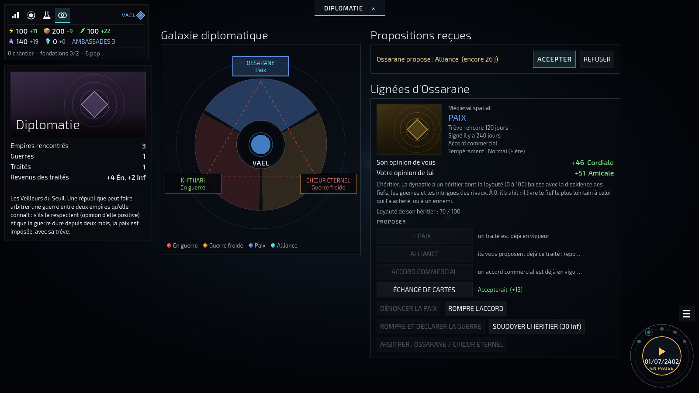

**Statuts et traités** (repris d'Endless Space 2) :

| Statut ou traité | Effet |
|---|---|
| Guerre froide | Statut de départ après la rencontre : pas de combat, chacun peut déclarer la guerre |
| Guerre | Combats, sièges, invasions ; un score de guerre compte les vaisseaux détruits et les systèmes pris |
| Paix | Aucune attaque ; une **trêve d'un an** suit la signature (pas de guerre possible) ; ensuite on peut dénoncer la paix (retour à la guerre froide) ou attaquer quand même et passer pour **parjure** aux yeux de toute la galaxie. +1 influence par mois |
| Alliance | Après six mois de paix. Les alliés **partagent leurs guerres** (qui attaque l'un a l'autre sur le dos, et l'allié d'un agresseur le suit), sauf s'ils sont liés par la paix à l'autre camp, et leurs cartes chaque mois, et voient en direct ce que voit l'autre. La quitter ramène à la guerre froide. +2 influence par mois |
| Accord commercial | Avec la paix : +4 énergie et +1 influence par mois chacun |
| Échange de cartes | Chacun reçoit les systèmes explorés par l'autre ; pas en guerre, pas plus d'une fois tous les deux ans |

Une proposition faite à une IA reçoit sa réponse tout de suite ; une proposition faite à un joueur humain l'attend 30 jours dans son écran Diplomatie (et un avis s'affiche). Un refus impose un délai avant de reproposer.

**Opinion** (de -100 à 100, ce qu'un empire pense d'un autre ; l'infobulle donne chaque raison) :

- le **choc des tons** du document de game design : une dissonance entre registres de -3 à +3 (×5), par exemple grimdark face au space opera héroïque -15 ;
- les **credos** (même credo +10, foi contre raison -10…), les **gouvernements** (féodalité contre république -5…), l'archétype (une ruche inspire l'horreur, -10) et certains traits (les Quarante peuples de Vael aiment tout le monde, le fanatisme du Chœur déteste les autres credos) ;
- les **frontières communes** (-3 par système voisin, jusqu'à -15) ;
- le statut (guerre -40, paix +10, alliance +20, commerce +5), la **confiance** qui monte de 2 par mois sous traité jusqu'à +30 (Stellaris), l'**ennemi commun** (+15) ;
- l'**histoire commune** : des souvenirs qui s'effacent avec le temps (déclaration de guerre, traité rompu, parjure, conquêtes, paix signée, allié venu à l'aide, héritier soudoyé, arbitrage…), comme les griefs de Civilization VI.

Tout cela porte sur les couches d'espèce (registre, credo, gouvernement, archétype, traits), pas sur l'identifiant d'une faction : une espèce créée dans l'éditeur obtiendra les mêmes réactions.

**Les talents diplomatiques des peuples** (eux aussi liés aux couches d'espèce, bloc `"abilities"`) :

| Talent | Qui | Effet |
|---|---|---|
| Faim sans traité | ruche + credo survie (l'Essaim Kh'thari) | Ne signe rien, ne reçoit rien, n'achète personne ; ne fait jamais la paix avec ses proies |
| L'héritier | toute féodalité (les Lignées d'Ossarane) | Loyauté de 0 à 100 : -6 par mois en dissidence des fiefs, -2 par guerre, + avec le temps et les traités. Les rivaux peuvent la **soudoyer** (30 influence, -15, et l'on s'en souvient) ; la dynastie offre un **banquet des lignées** (20 influence et 3 cristaux, +20). À 0, l'héritier **trahit** : il livre le fief le plus lointain à celui qui l'a acheté (ou à un ennemi), puis un nouvel héritier prend sa place |
| Les Veilleurs du Seuil | toute république (la Concorde de Vael) | **Arbitrer** la guerre entre deux empires connus : si elle dure depuis deux mois et que les deux camps respectent l'arbitre (opinion positive), la paix est imposée avec sa trêve (40 influence, une fois par an). Inspiré des trêves forcées des factions pacifistes d'Endless Space 2 |
| Pas de paix avec les hérétiques | théocratie + credo foi (le Chœur Éternel) | Déclarer la guerre à un autre credo : +10 ferveur ; chaque traité de paix avec un autre credo : -1 ferveur par mois |

**L'IA.** Elle juge chaque offre en additionnant des raisons lisibles, que le joueur voit avant de proposer (« Accepterait (+13) » et le détail en infobulle, comme la barre d'Endless Space 2 qui montre ce que l'autre pense de l'offre) : l'opinion, la lassitude et le cours de la guerre, le rapport de forces (la « pression » d'ES2), l'ennemi commun, les guerres d'un futur allié qui ne sont pas les siennes, et le **tempérament** (un belliqueux signe moins volontiers qu'un pacifique). Elle propose d'elle-même ce qu'elle accepterait avec une marge, au plus une proposition par réflexion, quitte une alliance qui ne lui plaît plus, et ne rompt un traité pour attaquer que si elle est belliqueuse et déteste sa cible. Par niveau : la Recrue juge à l'humeur du jour (un écart fixe pour le mois, déterministe), ignore le rapport de forces, offre son banquet trop tard, achète n'importe quel héritier et arbitre la première guerre venue ; le Normal compte les bases ; le Vétéran et au-dessus pèsent tout, soudoient les héritiers de leurs ennemis et arbitrent quand un ami perd. Sur des parties de 2000 jours entre IA, Vael et Ossarane finissent alliés, l'alliance entraîne Ossarane contre le Chœur, et au niveau Vétéran Vael finit par signer la paix avec le Chœur ; l'Essaim, lui, ne signe jamais.

**Interface.** L'écran Diplomatie (F4) reprend l'écran des statuts d'Endless Space 2 : votre empire au centre d'un anneau, les autres tout autour, un secteur coloré par statut (rouge la guerre, ambre la guerre froide, bleu la paix, cyan l'alliance) et des cordes pour les guerres et alliances entre les autres. À droite : les propositions reçues (accepter, refuser), puis la relation avec l'empire choisi (statut, trêve, score de guerre, opinions dans les deux sens, talents de son peuple, un bouton par traité avec le verdict de l'IA, rompre, déclarer la guerre, soudoyer l'héritier, arbitrer). À gauche : le bilan, les talents de votre peuple et, pour une dynastie, la loyauté de l'héritier et le banquet.

Nouveaux ordres : `propose_treaty`, `answer_proposal`, `cancel_treaty`, `bribe_heir`, `banquet`, `mediate`. Sauvegarde en version 7 (relations, souvenirs, propositions, héritier). Captures : `tools/capture_diplomacy.gd`.

Sources consultées :

- Endless Space 2 : [guide Gamepressure de la diplomatie](https://www.gamepressure.com/endless-space-2/diplomacy/z49cce) (guerre froide par défaut, paix sans aucune attaque, alliance, frontières, accord commercial, échange de cartes, écran de négociation qui montre ce que l'autre pense de l'offre), [mise à jour 1.1.0 « Galactic Statecraft »](https://community.amplitude-studios.com/amplitude-studios/endless-space-2/blogs/586-update-1-1-0-galactic-statecraft) (quitter une alliance ramène à la guerre froide), [billet sur la pression diplomatique](https://community.amplitude-studios.com/amplitude-studios/endless-space-2/blogs/584-galactic-statecraft-pressure-retake-constellation-control) (rapport de forces, friction de frontière), [wiki des statuts](https://endlessspace.fandom.com/wiki/Diplomatic_Status) et discussions de joueurs sur les trêves forcées des pacifistes et leurs délais ; la capture « Endless Space 2 - Diplomacy » de la [galerie hudsandguis](https://www.hudsandguis.com/home/2017/7/6/endless-space-2) pour la table des statuts.
- Stellaris : [notes de la mise à jour Asimov](https://forum.paradoxplaza.com/forum/threads/asimov-update-1-2-released-checksum-2352-not-for-problem-reports.953141/) et [journal 315](https://admin-forum.paradoxplaza.com/forum/developer-diary/stellaris-dev-diary-315-the-velvet-glove.1600119/) (la confiance qui monte avec les traités), discussions de moddeurs sur la friction de frontière et la menace commune.
- Civilization VI : [casus belli](https://civilization.fandom.com/wiki/Casus_Belli_(Civ6)) et discussions sur les griefs (les offenses qui pèsent puis s'effacent).
- Document de game design : opinion selon la dissonance des registres, les credos et l'histoire commune ; V1 = guerre, paix, alliance ; l'héritier qui trahit ; les Veilleurs du Seuil qui arbitrent ; l'Essaim sans diplomatie.
- De mémoire ou choix maison (non vérifié) : tous les chiffres (durées, valeurs d'opinion, revenus, coûts), la table de dissonance entre registres, le banquet et la bourse de l'héritier.

Pas encore fait : vassalisation, conseil galactique, contrats de mercenaires, exigences et menaces (la pression d'ES2 sert pour l'instant au jugement de l'IA), héros (ils viendront avec le système de personnages du GDD), vision partagée en temps réel entre alliés (les cartes s'échangent une fois par mois).

## Recherche

Une seule ressource de recherche, le **Savoir**, et un arbre entièrement visible de quatre domaines (Armement, Génie spatial, Économie, Société) sur cinq ères, comme dans Endless Space 2. Le premier lot a posé environ 65 technologies par peuple, surtout dans les ères 1 à 3 ; le deuxième (plus bas) ajoute les marques IV-V et les doctrines.

- **Savoir.** Chaque colonie en produit 1 pour 5 habitants, la capitale 8 de plus, et le bâtiment de recherche du peuple apporte le reste : Académie (et +10 % dans sa colonie), Scriptorium du Chœur (qui chante aussi : +1 ferveur par mois), Université des Quarante de Vael, Ganglion de mémoire de l'Essaim (nourri de nourriture). Il s'accumule ; chaque mois la technologie en tête de file en consomme jusqu'à deux fois le revenu (ou un douzième de la réserve si elle est grosse).
- **Coût.** Base de l'ère (30, 120, 320, 800, 1 900, ×3), +2,5 % par technologie déjà connue, +5 % par colonie au-delà de 5 : un grand empire paie sa recherche plus cher.
- **Ères.** Une ère s'ouvre dans un domaine quand on y connaît assez de technologies de l'ère précédente (2, 3, 3, 4). La file compte comme acquis ce qu'elle contient : on peut planifier une chaîne. Changer de recherche en cours met le travail entamé de côté, il est retrouvé quand on y revient.
- **Contenu derrière des technologies.** Transport, Croiseur, Torpilleur, Bombarde, Cuirassé, Porte-vaisseaux, Titan et Martyr, ainsi que la Raffinerie, les Habitats, le Bastion, l'Arsenal et le Chantier titanesque, demandent maintenant leurs technologies. Les alliances demandent les Chancelleries des deux côtés. Corvette, Frégate et Escorteur restent libres.
- **Effets.** Marques d'armes et de défenses (voir Arsenal), vitesse, coût et durée des vaisseaux, entretien, vision des colonies, production, croissance, fondations simultanées, emplacements, habitabilité (mondes toxiques, géantes gazeuses avec les cités flottantes), troupes et garnisons.
- **Technologies de peuple** (par couches d'espèce, comme les classes de vaisseaux : un peuple de l'éditeur qui partage la combinaison y a droit). Variantes qui remplacent une technologie commune (Scriptorium, Griffes, Routes des lignées, Serviteurs…), exclusives (Litanies, Charge sacrée, Duellistes, Ban des vassaux, Au dernier moment, Couvées…), hérétiques (Intelligences de bord et Génétique : 50 % plus chères et coûteuses en ferveur pour le registre Grimdark) et interdites (Automatisation pour le Chœur). Certaines ne valent que pendant l'Exaltation.
- **Talents de recherche des peuples.** Ossarane : technologies de saut 25 % moins chères. Chœur : Savoir -20 %, société +25 %, +5 ferveur par technologie d'armement, +4 Savoir par vaisseau ennemi détruit. Vael : +5 % de Savoir par empire en paix ou allié (20 % au plus). Kh'thari : Savoir divisé par deux, mais +2 Savoir par population digérée et +8 par vaisseau détruit.
- **IA.** Elle garde deux technologies en file, pèse l'intérêt de chaque domaine (tempérament, guerre en cours, penchant du peuple) contre le coût, construit un bâtiment de recherche pour cinq colonies, et évite les hérésies ; la Recrue choisit avec du bruit et ne voit pas l'hérésie.

### Arsenal : marques, doctrines, épaves, eurêkas

Le deuxième lot relie la recherche au combat et à ce qui se passe dans la partie. L'arbre compte 107 technologies.

- **Marques I à V.** Les 6 familles d'armes (cinétique, rayons, missiles, torpilles, artillerie, chasseurs) et les 3 défenses (blindage, boucliers, défense ponctuelle) montent chacune de la marque I à la marque V, +20 % par marque, comme les lignes d'armes de Galactic Civilizations. Dix technologies d'ères 4 et 5 complètent les marques IV et V.
- **Chaque vaisseau garde ses marques.** Un vaisseau sort du chantier avec les marques du moment et les garde. Une flotte à quai dans un système où l'empire a une colonie peut passer **au chantier** (bouton REMISE À NIVEAU) : 10 % du prix des vaisseaux en retard, 5 jours ; partir ou se battre interrompt les travaux. L'IA remet ses flottes à niveau quand elle est en paix.
- **Doctrines.** Trois paires exclusives en Armement (ères 2, 3, 4), comme les choix exclusifs d'Endless Space 2 : Rideau d'acier (l'écran encaisse 20 % de moins) ou Frappe en profondeur (25 % des tirs ignorent les rangs) ; Feu lointain (+15 % à longue portée, -10 % à courte) ou Abordage (+15 % à courte portée, +25 % de troupes) ; Guerre d'usure (réparations doublées, sièges +25 %) ou Guerre éclair (+20 % de vitesse, +10 % de dégâts le premier jour). Le choix est définitif : l'autre branche ne s'obtient plus que par les épaves.
- **Épaves** (Stellaris). Le vainqueur d'une bataille étudie les vaincus : 10 % de la marque suivante dans chaque famille où ils le dépassent, et 10 % de chacune de leurs doctrines. Reliques saintes du Chœur : deux fois plus ; Mémoire génétique de l'Essaim : trois fois plus. Une technologie entièrement payée ainsi est découverte aussitôt. Le rapport de bataille liste les épaves étudiées.
- **Eurêkas** (Civilization VI). 42 technologies ont un objectif en jeu qui paie 40 % de leur coût, une fois : rencontrer des empires, fonder des colonies, tenir des gisements, coloniser un type de monde, détruire ou perdre des vaisseaux, gagner des batailles, subir un siège, signer une paix ou un accord commercial, atteindre l'Exaltation... Vérifiés chaque trimestre. La fiche montre l'objectif et son avancement ; dans l'arbre, un point doré marque l'eurêka (plein une fois obtenu) et un trait doré le Savoir déjà acquis.
- **Pas encore là** : les technologies ultimes de l'ère 5 (Économie et Société n'ont pas encore d'ère 4), les modules et l'éditeur de vaisseaux, le commerce de technologies.

Sources (étude citée plus haut) : familles d'armes en marques de [Galactic Civilizations II](https://galciv.fandom.com/wiki/Technology), choix exclusifs d'[Endless Space 2](https://endless-space-2.fandom.com/wiki/Technology), analyse des épaves de [Stellaris](https://stellaris.paradoxwikis.com/Technology), eurêkas de [Civilization VI](https://civilization.fandom.com/wiki/Boost_(Civ6)) (40 % depuis Rise and Fall). Choix maison : les chiffres des doctrines, le prix et la durée de la remise à niveau, la liste des objectifs.

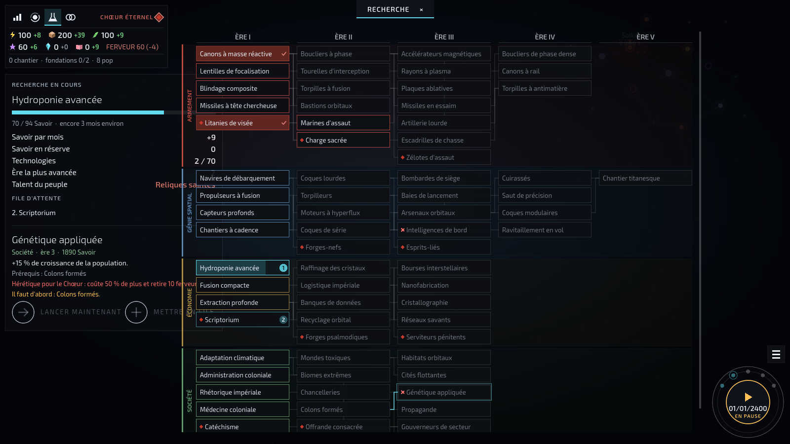

**Rythme.** Calibré pour une partie d'environ 3 heures à la vitesse normale (0,5 seconde par jour) sur une vraie partie entre IA de niveau Normal : une dizaine de technologies au premier quart d'heure, l'ère 3 vers la demi-heure, une soixantaine de technologies à 3 heures pour un grand empire. À rejouer à la main.

Sources (consultées pour l'étude, voir le [document d'étude](https://claude.ai/artifact/VZPzNQD33eoKTu8FgYQAC1) et la [maquette de l'arbre du Chœur](https://claude.ai/artifact/4UzS2fXPdfBGcRaDS6w2Vt)) : le [wiki d'Endless Space 2 sur les technologies](https://endless-space-2.fandom.com/wiki/Technology) (arbre visible en domaines et ères à seuils, coût qui monte avec chaque technologie connue, technologies de peuple), le [wiki de Stellaris](https://stellaris.paradoxwikis.com/Technology) (coût qui grandit avec l'empire, choix pondérés de l'IA), le [wiki de Galactic Civilizations II](https://galciv.fandom.com/wiki/Technology) (familles d'armes en marques). De mémoire ou choix maison : tous les chiffres, les seuils et la dépense du Savoir stocké.

## Catalogue de vaisseaux

Le combat garde sa bataille automatique en trois phases ; le catalogue l'enrichit pour que chaque classe ait un usage et un contre. Tout est dans `data/ships.json` et `data/combat.json`. L'étude qui a mené à ces choix (dix jeux comparés, sources, décisions) : [Étude : systèmes de combat et types de vaisseaux](https://claude.ai/artifact/497ptZZyfqQfhcSajXLkTh).

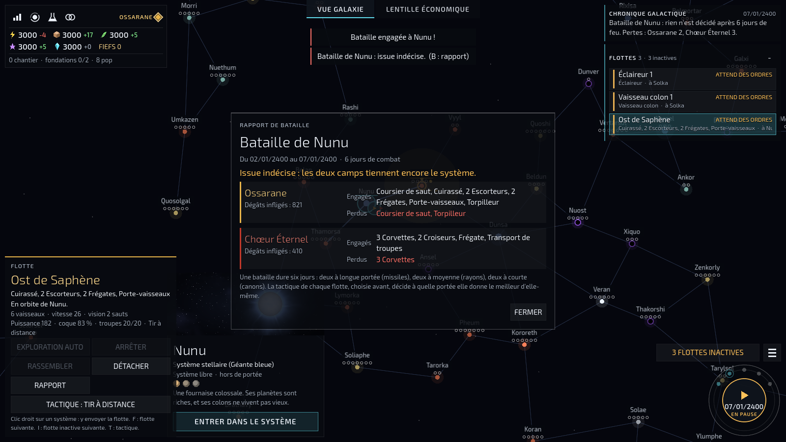

**Nouvelles règles de bataille**

- **Écran, ligne, arrière.** Chaque classe a un rang. Les tirs visent surtout l'écran (poids 3), puis la ligne (poids 2) ; l'arrière n'est visé que quand il ne reste plus ni écran ni ligne. Les chasseurs, eux, frappent partout. Inspiré des rôles et positions de départ de [Galactic Civilizations IV](https://wiki.galciv.com/index.php/GalCiv4:Spaceship_Battles) et des rôles d'[Endless Space 2](https://www.gamepressure.com/endless-space-2/roles-and-types-of-ships/z29cd2).
- **Défense ponctuelle.** Missiles, torpilles et chasseurs sont en partie abattus par la défense ponctuelle de la cible et par celle que les escorteurs prêtent à toute leur flotte (plafond 60 %). Inspiré de la flak et de la défense ponctuelle de Stellaris ([journal de développement 271](https://devtrackers.gg/stellaris/p/d228cc12-stellaris-dev-diary-271-ready-fight)).
- **Taille des coques.** Les torpilles frappent plus fort les grosses coques (40 % contre une petite, 250 % contre un titan) ; l'artillerie lourde écrase de loin mais ne tire plus à courte portée. Même source : bonus de taille des torpilles et portée minimale des grosses armes dans Stellaris.

**Les classes communes**

| Classe | Rang | Rôle | Particularité |
| --- | --- | --- | --- |
| Corvette | Écran | Chasse | Canons cinétiques, mortelle au contact |
| Escorteur | Écran | Antimissile | Défense ponctuelle 30 %, +15 % à toute sa flotte |
| Frégate | Ligne | Ligne | Rayons à moyenne portée, boucliers |
| Torpilleur | Ligne | Anti-gros | Torpilles, bonus contre les grandes coques et le titan |
| Croiseur | Ligne | Siège | Missiles, blindage, 12 troupes |
| Transport de troupes | Arrière | Invasion | 30 troupes, aucune arme |
| Bombarde | Arrière | Siège | Siège 8 : use la garnison bien plus vite |
| Cuirassé | Arrière | Artillerie | Artillerie lourde, rien à courte portée ; demande un **arsenal orbital** |
| Porte-vaisseaux | Arrière | Chasseurs | Chasseurs qui ignorent les rangs ; demande un arsenal orbital |
| Titan | Ligne | Méga-vaisseau | Premier échelon des méga-vaisseaux : un seul par empire, demande un **chantier titanesque** (qui demande un arsenal), annoncé à toute la galaxie |

**Les classes de peuple.** Une classe de peuple existe quand elle a du sens pour lui. Elle ne dépend pas de l'identifiant de la faction mais des **couches d'espèce** du GDD (registre, archétype, gouvernement, credo, traits ; bloc `"species"` de `data/factions.json`) : une espèce créée plus tard dans l'éditeur qui partage la combinaison y aura droit aussi. L'idée vient des armes du Colosse de Stellaris, qui dépendent des éthiques de l'empire ([guide](https://gamerempire.net/?p=55930)).

| Classe | Condition d'espèce | Peuple V1 | Effet |
| --- | --- | --- | --- |
| Coursier de saut | trait « navigateurs » | Ossarane | Remplace la corvette ; une flotte de coursiers traverse les blocus |
| Martyr | credo « foi » | Chœur Éternel | S'ajoute ; payé en population, il se sacrifie à courte portée (gros dégâts, +5 ferveur) |
| Frégate des Quarante | trait « pluriel » | Vael | Remplace la frégate ; ouvre la tactique **Adaptative** à sa flotte |
| Ruche-mère | archétype « ruche » | Kh'thari | Remplace le porte-vaisseaux ; payée en nourriture et en population plutôt qu'en métal |

**L'IA et le catalogue.** La Recrue pioche au hasard dans ce qu'elle peut construire. Le Normal ajoute un escorteur de temps en temps et des transports quand les troupes manquent. Le Vétéran et au-dessus gardent un tiers d'écran, prennent des escorteurs contre les missiles et chasseurs ennemis, des torpilleurs contre les grosses coques, des cuirassés ou porte-vaisseaux une fois l'arsenal bâti, une bombarde pour les sièges, et lancent leur titan dès que possible. Toutes utilisent la classe de leur peuple à la place du modèle commun, et la tactique Adaptative quand elles l'ont.

À venir, selon l'étude : les familles d'armes, modules et doctrines viendront avec la couche de technologies ; les échelons de méga-vaisseaux au-dessus du titan (faits : Léviathan et Nef-monde, voir l'éditeur de vaisseaux).

### Éditeur de vaisseaux (lot 1 : le moteur)

Étude sourcée (Endless Space 2, Stellaris, Galactic Civilizations IV, Master of Orion II) : https://claude.ai/artifact/F51fEJz4ATWYVRL1Pk7ftb

- Un vaisseau = une **coque** (`data/designs.json`, `hulls`) + ses **modules intégrés** (coques de peuple, jamais retirables) + les **modules posés** dans ses emplacements typés : armes, lourds (artillerie, hangars), défense, soutien, titanesque. Les types d'emplacements sont des données (`slot_types`, champ `accepts`) : un échelon de méga-coque au-delà du titan ajoute le sien sans toucher au code.
- La valeur d'un module dépend de la taille de la coque (petite, moyenne, grande, titan), comme les tailles d'emplacements de Stellaris. Un emplacement vide ne coûte rien : le vaisseau est moins cher et sort plus vite.
- Les classes de combat de `data/ships.json` sont des **modèles d'origine** (`origin`) : leurs caractéristiques sont calculées depuis leur coque et leurs modules. Corvette, frégate, croiseur, cuirassé, porte-vaisseaux, titan, martyr et ruche-mère gardent exactement leurs chiffres ; escorteur, torpilleur, transport, bombarde, coursier et frégate des Quarante, devenus des modèles sur une coque commune ou de peuple, bougent un peu.
- Les modèles conçus en partie vivent dans `GameState.designs` (sauvegarde version 10 ; les parties version 9 se chargent encore) : nom, coque, modules, rang (écran, ligne, arrière), priorité de cible, version. Une nouvelle version garde la coque et retire l'ancienne de la liste de construction ; les vaisseaux déjà construits restent tels quels. `GameData.ship()` les lit comme des classes, donc combat, flottes et chantiers fonctionnent sans changement.
- Commandes : `SimCommands.save_design`, `SimCommands.retire_design`. Tests : `tests/design_tests.gd`.
- **Écran Chantier** (F6, lot 2) : modèles rangés par coque à gauche (« + Coque » ouvre un brouillon vierge), coque schématique au centre avec ses emplacements colorés par type (clic : choisir, clic droit : vider), modules de l'emplacement choisi à droite avec leur effet pour cette taille de coque, caractéristiques en bas comparées au modèle affiché (dégâts par phase, coque, défenses, vitesse, coût, durée). Enregistrer, nouvelle version, retirer ou remettre en service. Captures : `tools/capture_shipyard.gd`.

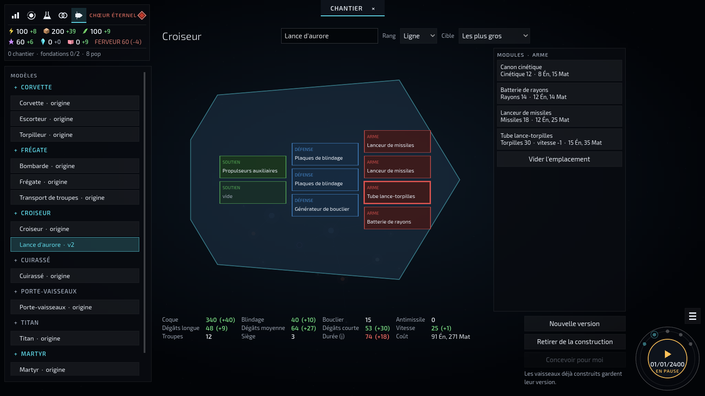

- **Conception automatique et IA** (lot 3) : `Designs.auto_design(state, empire, coque, rôle, qualité)` remplit une coque pour un rôle (assaut, ligne, escorte, torpilleur, artillerie, porteur, invasion, siège). Qualité 0 : modules au hasard parmi ceux qui conviennent ; 1 : équilibré ; 2 : défenses et armes adaptées à ce que l'empire a affronté (`Designs.threat`, d'après ses rapports de bataille). Le bouton « Concevoir pour moi » du Chantier s'en sert (qualité 2). Chaque IA conçoit, une fois par mois, un modèle par classe d'origine qu'elle sait construire (même coque, même rôle), le renouvelle quand elle a découvert des technologies ou beaucoup combattu, et le construit à la place de la classe. La qualité suit son niveau militaire (Recrue maladroite, Normal équilibré, Vétéran et au-delà adaptés).
- **Lot 4** :
  - **Priorité de cible appliquée en bataille** : « les plus gros » / « les plus petits » pondèrent les cibles selon leur taille, « porteurs et arrière » les porteurs et l'arrière ; l'écran protège toujours ce qui est derrière lui tant qu'il tient.
  - **Miniaturisation** (`miniaturisation` dans `data/designs.json`) : à la marque III, l'artillerie tient dans un emplacement d'arme d'une grande coque, un hangar léger dans celui d'une frégate, l'antimissile dans un emplacement de soutien.
  - **Hangars** : intercepteurs (couvrent la flotte), chasseurs, bombardiers (nouvelle famille d'armes, forte contre les grosses coques, marque des chasseurs).
  - **Modules titanesques** : lance stellaire (nouvelle famille d'armes), bouclier de flotte (s'ajoute au bouclier de chaque vaisseau de la flotte), hangar géant, canon de siège planétaire.
  - La conception automatique (joueur et IA) mélange les hangars, diversifie armes et soutiens, et profite de la miniaturisation.
- **Échelons au-dessus du titan** : chaque méga-coque garde les emplacements titanesques et ajoute son propre type, qui accepte aussi les modules des échelons inférieurs. Un seul vaisseau de chaque coque par empire, au Chantier titanesque.

| Échelon | Coque | Technologie | Emplacement propre | Modules de l'échelon |
|---|---|---|---|---|
| 1 | Titan | Chantier titanesque | Titanesque ×1 | Lance stellaire, bouclier de flotte, hangar géant, canon de siège |
| 2 | Léviathan (cœur : antimissile de flotte) | Léviathans | Titanesque ×2, **colossal** ×1 | **Forge mobile** (la flotte se répare partout comme chez elle), **canon à singularité** (nouvelle famille d'armes qui ignore blindage et boucliers, terrible contre les grosses coques ; demande aussi les Canons à singularité) |
| 3 | Nef-monde (cœur : cité de bord, les troupes se reforment partout) | Nefs-mondes | Titanesque ×2, colossal ×1, **astral** ×1 | **Moteur de trame** (toute la flotte avance au moins à sa vitesse), **brise-monde** (siège en quelques jours) |

  Chaque échelon a trois coques au choix, et l'empire n'a qu'**un seul méga-vaisseau par échelon, toutes variantes confondues** (A arme, L lourd, D défense, S soutien, T titanesque, C colossal, As astral) :

| Échelon | Bataille | Porteuse (à l'arrière) | Bastion / siège |
|---|---|---|---|
| Titan | A6 L3 D6 S5 T1 | A2 L6 D5 S5 T1 | Bastion (écran) : A3 L2 D9 S6 T1, plus de coque, plus lent |
| Léviathan | A8 L4 D8 S6 T2 C1 | A3 L9 D7 S7 T2 C1 | De siège : A5 L5 D8 S8 T1 C2 |
| Nef-monde | A10 L5 D10 S8 T2 C1 As1 | A4 L11 D9 S9 T2 C1 As1 | Bastion (écran) : A6 L6 D11 S11 T1 C1 As2 |

  Les IA conçoivent et lancent aussi leurs méga-vaisseaux, en commençant par l'échelon le plus haut qu'elles savent construire ; chacune a sa variante préférée.

  Autres modules des emplacements de méga-coques :
  - titanesques : **dôme antimissile** (antimissile de toute la flotte), **caserne titanesque** (de quoi envahir sans transports), **œil du titan** (+3 sauts de vision) ; ils demandent le Chantier titanesque plus Interception, Marines ou Saut de précision ;
  - colossal : **ancre gravitationnelle** (tant que la bataille dure, aucune flotte ennemie en guerre ne peut quitter le système ; technologie Puits de gravité) ;
  - astraux : **soleil captif** (lance stellaire géante), **cœur-étoile** (entretien négatif : le vaisseau rapporte de l'énergie chaque mois) ; technologie Étoiles captives ;
  - modules de peuple (`"requires": {"species": …}` sur le module, réservés aux peuples qui remplissent la condition) : **propulseurs de navigateurs** (Ossarane, titanesque : force les blocus, plus rapide), **noyau des Quarante** (Vael, titanesque : tactique Adaptative), **reliquaire du dieu-machine** (Chœur, titanesque : +10 de ferveur à chaque victoire), **ventre digesteur** (Kh'thari, colossal : un quart du coût en matériaux des vaisseaux ennemis détruits). La conception automatique monte le module du peuple dès que la coque a un deuxième emplacement de méga-coque. Les conditions portent sur les couches d'espèce (et peuvent en combiner plusieurs) : une espèce personnalisée obtient les modules de sa combinaison. L'arbre de recherche affiche les coques et modules que chaque technologie débloque.
  Les grandes équipes des méga-chantiers posent plusieurs modules à la fois (durée des modules à 60 % sur le Léviathan, 40 % sur la Nef-monde). Blindage et boucliers empilés plafonnent à 75 % (`defense_cap`, les technologies montent jusqu'à 90 %), pour qu'une méga-coque bardée reste vulnérable.

## Victoires

Étude sourcée (Civilization VI, Galactic Civilizations III, Stellaris, Old World, Endless Space 2) : [Claude Doc](https://claude.ai/artifact/TYX252JaLg64V6qQhUpXm2). Règles en données dans `data/victories.json`, calculs dans `Victory`, vérification mensuelle dans `VictorySystem`.

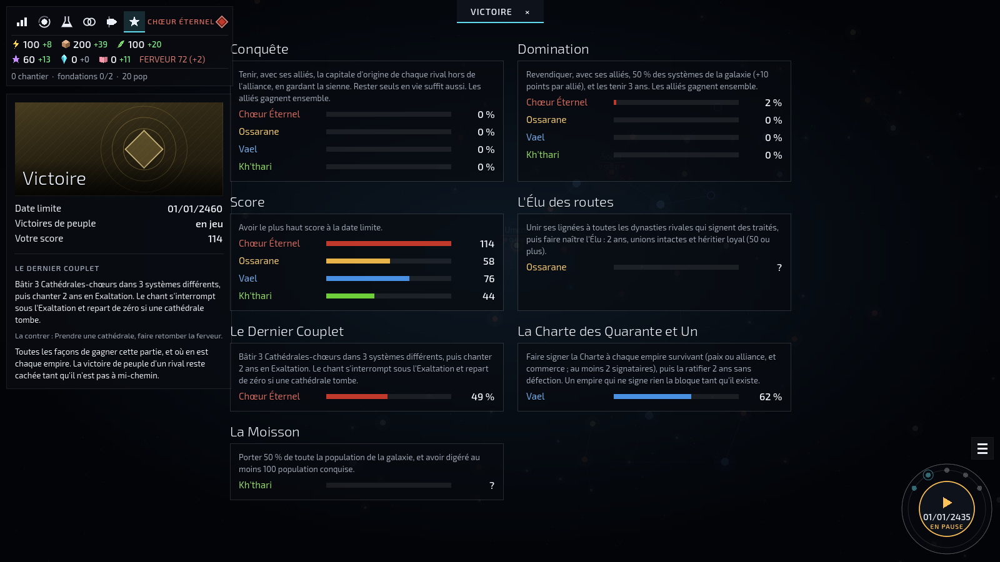

- **Trois victoires pour tous** :
  - **Conquête** : tenir la capitale d'origine de chaque empire hors de son alliance, en gardant la sienne (ou être seul encore en vie avec ses alliés).
  - **Domination** : tenir 50 % des systèmes de la galaxie pendant 3 ans. Les systèmes des alliés comptent, mais chaque allié ajoute 10 points au seuil (plafond 90 %).
  - **Score** : à la date limite choisie dans Nouvelle partie (30, 60 ou 90 ans, ou aucune ; 60 par défaut), l'empire en tête du classement gagne. Le score compte population, colonies, avant-postes, technologies, vaisseaux détruits, conquêtes, exploration et peuples.
  - Conquête et Domination se gagnent **en alliance**, comme dans Endless Space 2 : les alliés partagent la victoire (« Victoire partagée »).
- **Une victoire par peuple**, tirée du GDD et débloquée par une technologie de Société de l'ère IV. Les conditions portent sur les couches d'espèce, donc une espèce personnalisée reçoit celles de sa combinaison :
  - **L'Élu des routes** (gouvernement féodal, Ossarane) : unir ses lignées à des alliés d'au moins 180 jours (bouton « Unir nos lignées » de la Diplomatie, 50 influence et 10 cristaux), garder l'héritier loyal (50 au moins), puis tenir 2 ans. Une union se rompt avec l'alliance.
  - **Le Dernier Couplet** (théocratie de foi, Chœur Éternel) : bâtir 3 cathédrales-chœurs dans 3 systèmes et chanter en Exaltation 2 ans ; le compte à rebours se fige quand le chœur se tait.
  - **La Charte des Quarante et Un** (république, Vael) : faire signer paix et commerce à au moins deux empires, et à tous les survivants qui acceptent les traités, puis tenir 2 ans.
  - **L'Éveil de la Noosphère** (conscience distribuée, Teyl) : relier au moins 12 colonies peuplées au réseau, sans une seule revendication coupée, et le tenir 2 ans ; une coupure remet le compte à rebours à zéro. Victoire inventée pour le jeu (le tableau du GDD n'en prévoit pas pour Teyl), sur le même principe : une règle lisible que les autres peuvent contrer en coupant le réseau.
  - **La Terre promise** (gouvernement horde, Ferrocornes ; GDD : « trouver et coloniser un monde promis caché, à l'aide d'indices ») : un monde habitable caché, à au moins 6 sauts du berceau, tiré d'un hachage de la partie (le même pour tous, sans hasard). La technologie « Chants de la route » donne à combien de sauts il est de la flotte-ville, puis le nomme à 2 sauts. Y fonder une colonie et y faire camper la flotte-ville 1 an ; si elle repart ou si la colonie tombe, le compte à rebours repart de zéro. Les autres peuvent la coloniser avant eux, la leur reprendre ou abattre la flotte-ville.
  - **La Légende** (registre Picaresque, Brisecomète ; GDD : « accomplir 7 exploits improbables ») : accomplir 7 exploits différents parmi 11 (vaincre une flotte trois fois plus forte, voler une technologie, siphonner l'énergie d'un rival, saboter un chantier, brûler des archives, semer la discorde, corrompre un héritier, obtenir un rapport complet, mener un contrat de flotte à terme, démasquer un réseau retourné, atteindre 100 de réputation), puis garder une réputation d'au moins 60 pendant 1 an. Le GDD demande aussi « au moins un héros » : le jeu n'a pas encore de héros, les exploits portent sur l'empire. Pour la contrer, il faut les battre : chaque bataille perdue coûte 8 de réputation.
  - **Le Silence parfait** (archétype Énergétique, Murmurants d'Abysse ; GDD : « survivre jusqu'à la fin sans jamais être détecté, avec X planètes », contre-jeu « technologies de détection ») : tenir au moins 8 colonies peuplées pendant 3 ans sans être repéré par un empire non allié (technologie « Le Grand Silence »). Chaque repérage remet le compte à rebours à zéro : « jusqu'à la fin » et « jamais » auraient rendu la victoire impossible dès qu'un voisin trouve les Détecteurs d'abysse. Pour la contrer : rechercher les Détecteurs et garder l'œil sur leurs systèmes, ou y laisser une flotte à l'arrêt.
  - **La Moisson** (archétype ruche, Kh'thari) : la moitié de la population galactique et 100 de population ennemie digérée, tenues 2 ans (le compte à rebours repart de zéro si l'Essaim retombe sous le seuil).
- **Avancée** de 0 à 100 % : à 75 % la condition est remplie et le compte à rebours commence. Sans la technologie de sa victoire de peuple, l'avancée plafonne à 74 %. Les autres empires voient une avancée à partir de 50 % (le spectateur voit tout), le chroniqueur alerte à 50 et 75 %, et l'IA prend le meneur en grippe (opinion -15 puis -30, guerre plus facile à 75 %).
- **Fin de partie** : panneau Victoire, Victoire partagée ou Défaite avec le mot du chroniqueur et le classement final ; on peut continuer la partie (plus aucune victoire n'est proclamée) ou revenir au menu.
- **IA** : chacune poursuit sa victoire de peuple (techniques et cathédrales, unions, traités), la Recrue plus maladroitement mais sans l'ignorer.
- Sauvegarde version 11 (les versions 9 et 10 se chargent, sans date limite). Captures : `tools/capture_victory.gd` ; parties entre IA jusqu'à la victoire : `tools/victory_bench.gd` (variables SEEDS, LEVEL, YEARS).

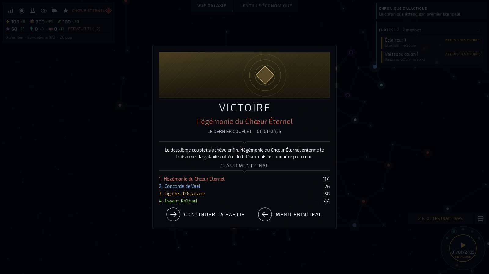

## Éditeur d'espèces

Le joueur pourra créer son propre peuple avec les mêmes briques que les 4 officiels. Le lot 1 pose les règles, la bibliothèque et le jeu des peuples créés ; le lot 2 l'écran. Étude de conception : [Éditeur d'espèces](https://claude.ai/artifact/6hHfLGyBr2iGm5ypxvuaX2), lignes directrices tirées de l'étude d'équilibrage.

- **Six couches, chacune avec un rôle** (`data/species_parts.json`) : registre (ton, opinion), archétype (le corps : la ruche essaime avec des vaisseaux-spores), gouvernement (la mécanique signature avec son défaut : fiefs, ferveur, vote d'urgence, faim sans traité), credo (le style de recherche), origine (gisement garanti, ou +1 point de traits) et deux biomes. Gratuits.
- **Traits sur un budget** : 4 points, 5 traits, 3 points de défauts au plus. Un trait de croissance (qui grandit avec la population) coûte 1 point de plus et un seul est permis ; un défaut qu'une autre couche annule est refusé (« Orateurs maladroits » avec une ruche qui colonise sans influence). Les 4 officiels recomposés coûtent 0 à 4 points.
- **Identité** : nom, nom court, histoire, couleur, portrait (toute la galerie au choix, ceux de l'archétype en premier ; portraits provisoires dessinés en attendant les illustrations `assets/art/portrait_<id>.png`), style de vaisseaux d'un officiel, tempérament de l'IA.
- **Bibliothèque** : chaque peuple est un fichier `user://species/<id>.json`, gardé d'une partie à l'autre et partageable. Au démarrage, chaque fichier est revérifié (un fichier modifié hors règles est écarté) et les peuples valides s'ajoutent aux officiels dans Nouvelle partie.
- **En partie** : un peuple créé joue comme un officiel (`Species.build` produit une fiche au format de `data/factions.json`), pour le joueur comme pour l'IA, avec les vaisseaux, modules, technologies et victoires de peuple de ses couches. La partie recopie sa fiche dans la sauvegarde (format 12) : elle se recharge même si le fichier a changé ou disparu. `GameState.create` accepte `"rivals"` pour choisir les peuples des autres empires.
- **Banc court** : `SPECIES=user://species/p_x.json SEEDS=1,...,24 godot --headless --path . -s res://tools/balance_bench.gd`, puis `python3 tools/balance_report.py` affiche si chaque peuple est dans la cible (victoires 10-45 %, morts avant l'an 10 < 25 %). `SPECIES=preset:choeur` essaie une copie d'un officiel.

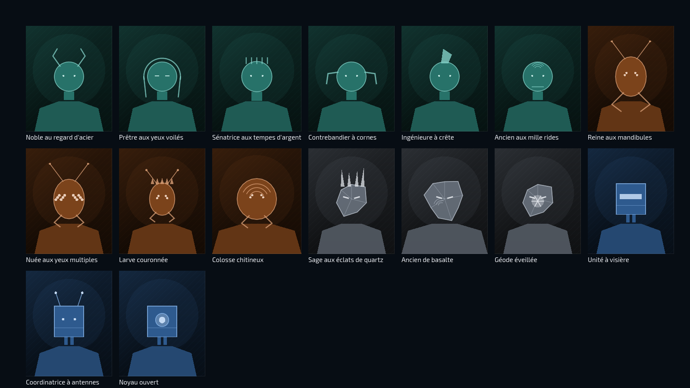

### Lot 2 : l'écran Peuples

L'entrée **Peuples** du menu principal (ou « Créer ou modifier un peuple… » dans Nouvelle partie) ouvre l'éditeur (`scripts/ui/species_editor.gd`) :

- **Bibliothèque** à gauche : partir d'un peuple officiel (ses couches et traits), ouvrir un de vos peuples, Nouveau, Dupliquer, Supprimer (deux clics ; les parties sauvegardées gardent leur copie). Les fichiers écartés au chargement y sont listés avec la raison.
- **Trois onglets** au centre : Identité (nom, nom court, couleur, style de vaisseaux, tempérament de l'IA, histoire, portrait choisi librement dans toute la galerie, ceux de l'archétype en tête), Couches (une liste par couche, avec ses règles et ce qu'elle demande), Traits (points restants, traits choisis retirables d'un clic, qualités et défauts avec leur coût ; un trait impossible est grisé avec la raison en bulle).
- **Aperçu** à droite : portrait, budget, raisons qui empêchent d'enregistrer (Enregistrer est grisé tant qu'il en reste), toutes les règles du peuple assemblé, et ce que débloquent ses couches (victoire de peuple, talents diplomatiques, vaisseaux propres).
- **Nouvelle partie** : les peuples enregistrés apparaissent aussitôt dans la rangée de portraits, et « Empires rivaux » choisit les peuples adverses, officiels ou créés (7 au plus ; le peuple joué n'est jamais son propre rival).

Sources consultées pour la mise en page : la création de civilisation de Galactic Civilizations IV (journal de développement #79 de Stardock, captures : onglets, grille de traits à points, portrait) et la capture de l'écran d'espèce du wiki officiel de Stellaris (compteurs de points et de traits restants, colonnes qualités/défauts avec leur coût). Aucune capture de l'éditeur de faction d'Endless Space 2 n'a été trouvée : le style visuel reste celui du reste du menu.

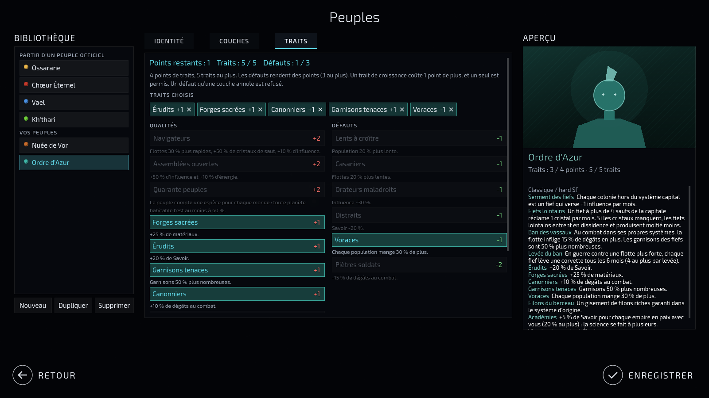

### Lot 3 : nouvelles briques, une à la fois

Chaque nouvelle brique apporte une vraie mécanique et passe au banc de 24 parties.

- **Archétype Lithoïde** : des corps de pierre et de cristal. Ce que les autres cultivent, ils l'extraient (la nourriture produite par les habitants devient des matériaux) et chacun mange 1 matériau par mois au lieu de nourriture ; sans matériaux, c'est la famine (`diet`). Population 25 % plus lente. Les mondes stériles leur sont habitables à 50 % (`hab_extra`). L'IA bâtit des mines plutôt que des fermes quand elle manque, et recherche les mondes que seul son corps peuple (`own_world_bonus`). Inspiration : les Lithoïdes de Stellaris, qui mangent des minéraux, grandissent 25 % moins vite et gagnent en habitabilité (journal de développement Paradox n° 157 et fils de joueurs, vus en extraits de recherche seulement : le forum Paradox refuse l'accès automatique). Banc (24 parties, 25 ans, IA Normale, « Concile de Basalte » : lithoïde, république, raison, filons, érudits + garnisons tenaces) : dans la cible de l'étude d'équilibrage (avec l'IA qui colonise la roche nue : 5 morts avant l'an 10, 18,1 systèmes à l'an 10, 12 % de victoires ; sans : 3, 21,4 et 17 %, écart dans le bruit d'un banc de 24 parties).
- **Archétype Synthétique** : des esprits dans des châssis. Pas de naissances : chaque nouvel habitant coûte 12 matériaux et la cadence ne ralentit pas quand la colonie grandit (`assembly`, `Economy.colony_threshold`) ; sans matériaux, la chaîne attend. Énergie au lieu de nourriture (`diet` = `energy`, la nourriture des habitants devient de l'énergie). Mondes toxiques habitables à 60 %. Inspiration : les robots et empires-machines de Stellaris (population assemblée, énergie au lieu de nourriture, plancher d'habitabilité), d'après des extraits de journaux de développement et de forums. Banc rapide (24 parties, « Noosphères d'essai ») : départ lent (5,7 systèmes à l'an 5), 29 % de morts avant l'an 10, 17 % de victoires ; l'équilibrage fin des peuples attendra une version plus figée du jeu.
- **Gouvernement Conscience distribuée** (document de game design, Noosphères de Teyl : « chaque colonie est un nœud, couper le réseau affaiblit tout ») : +5 % de Savoir par colonie reliée à la capitale (50 % au plus). Un nœud est relié si l'on va de proche en proche jusqu'à la capitale par des systèmes à soi ou à personne, sans blocus ennemi (`FactionTraits.network_systems`) ; une revendication coupée produit moitié moins. La jauge « Réseau » du panneau d'empire compte les nœuds et signale les coupures. Mécanique propre au jeu, sans modèle direct chez les autres 4X consultés. Banc rapide « Réseau d'essai » (synthétique + conscience) : 25 % de morts avant l'an 10 et 8 % de victoires, départ un peu lent ; l'équilibrage est reporté à une version plus figée.
- **Noosphères de Teyl, 5e peuple officiel** (document de game design : classique / hard SF, synthétique, « recherche, optimisation ») : synthétique, conscience distribuée, raison, Cœur brûlant, Érudits et Fonderies optimisées. Ses règles sont exactement celles de ses briques (vérifié par les tests), avec sa victoire de peuple, l'Éveil de la Noosphère. Il entre dans les parties par défaut, qui passent à 5 empires. Banc rapide à cinq peuples (24 parties, IA Normale) : Teyl 4 % de morts avant l'an 10 et 30 systèmes à l'an 20, mais l'arrivée d'un cinquième voisin pèse sur les autres (Kh'thari 50 % de morts précoces, Vael 54 % de victoires). L'équilibrage reste reporté à une version plus figée.
- **Gouvernement Syndicat** (document de game design, Syndicat Brisecomète : « loue ses flottes, ne colonise presque pas ») : **flottes à louer**, un talent diplomatique. Depuis la Diplomatie, le syndicat propose ses flottes à un empire en guerre (« Louer nos flottes contre… »), ou un empire en guerre les engage (« Engager contre… »). Le syndicat entre alors en guerre contre la cible, et le client le paie chaque mois en énergie : 8, plus 2 par vaisseau armé, prix fixé à la signature. Le contrat dure tant que dure la guerre du client, deux ans au plus. Ensuite, les mercenaires signent la paix avec leur ancienne cible, et le client s'en souvient en bien. Un client sans énergie perd ses mercenaires et leur estime. Un contrat à la fois, 90 jours de repos entre deux. Les avant-postes sont des **comptoirs** (+2 énergie), une vraie colonie coûte deux fois plus d'influence, et le syndicat part avec deux corvettes. Jauge « Contrat » au panneau d'empire. L'IA syndicat loue ses flottes au client qui en veut le plus, l'IA cliente juge le prix, le rapport de forces et son trésor (`AiDiplomacy.evaluate_contract`). Inspiration : les enclaves de mercenaires de Stellaris ([journal de développement 249](https://forum.paradoxplaza.com/forum/developer-diary/stellaris-dev-diary-249-new-friends.1518971/) : une flotte louée à qui peut payer, pour dix ans), et les Lumeris d'Endless Space 2, qui achètent leurs avant-postes au lieu de coloniser ([guide Gamepressure](https://gamepressure.com/endless-space-2/lumeris/z59ced)). Banc rapide « Comptoir d'essai » (humanoïde, syndicat, raison ; 24 parties à six peuples) : 21 % de morts avant l'an 10, 24 systèmes à l'an 20, 4 % de victoires. À six empires, l'Essaim meurt tôt dans 83 % des parties et Vael gagne 62 % des parties (la Charte). L'équilibrage reste reporté.
- **Credo Profit** (Brisecomète : « vole des technologies ») : Savoir -15 %, mais tous les six mois, des espions volent 60 % de la technologie la plus chère qu'un voisin connaît et que le peuple peut chercher (`Research.steal_month`). Ils se font prendre une fois sur trois, une sur six chez un partenaire commercial. La prise est décidée sans hasard, par un hachage de la partie, du jour et des deux empires. Une victime qui les prend s'en souvient (-20 d'opinion, cumulable trois fois). Inspiration : l'opération « Steal Technology » de l'espionnage de Stellaris (une technologie que la cible connaît et pas vous ; [guide](https://doublexp.com/guides/how-espionage-works-in-stellaris)), sans réseau d'espions à entretenir. Banc rapide « Marchands d'essai » (humanoïde, république, profit ; 24 parties à six peuples) : 17 % de morts avant l'an 10, 25 systèmes à l'an 10, dans la cible.
- **Gouvernement Horde** (document de game design, Clans Ferrocornes : « flottes-villes itinérantes, aucune planète capitale », « raids, pillage, honneur ») : pas de planète capitale. La capitale est une **flotte-ville** (`flotte_ville`, vaisseau « capital » unique, armé, lent), qui rapporte ce que rapporte un palais (3 énergie, 3 matériaux, 5 influence, 8 Savoir) et se déplace ; le monde natal n'a ni palais ni garnison de capitale. **Campement** : les revendications du système où elle est à l'arrêt produisent 50 % de plus. **Le clan suit la flotte** : celles à plus de 4 sauts produisent 30 % de moins, et toutes si la flotte-ville est détruite (elle se reconstruit dans un chantier, une à la fois). **Pillage** : en guerre, chaque vaisseau armé à l'arrêt dans un système ennemi y prend chaque mois 6 matériaux et 4 énergie dans les réserves de l'empire visé. Tant que la flotte-ville vogue, le clan ne disparaît pas, même sans planète ; pour la victoire de conquête, sa capitale est prise quand elle est abattue. Jauge « Flotte-ville » au panneau d'empire. L'IA fait camper sa flotte-ville dans son système le plus peuplé, loin des flottes ennemies, et la reforge si elle la perd (`FactionTraits.city_fleet`, `camp_system`, `far_from_clan`, `loot_plan` ; `AiPlayer.city_camp`). Inspiration : les hordes de Total War: Attila, dont l'armée est la ville et qui campent pour bâtir puis pillent en route ([Gamepressure](https://www.gamepressure.com/totalwarattila/horde/z173dc)), l'arche-capitale des empires nomades de Stellaris: Nomads, juin 2026 ([guide After Strategy](https://after-strategy.com/en/stellaris-nomads-guide-nomadic-empires-2026/) : capitale, chantier et forteresse mobile, dont la perte est catastrophique), et les maraudeurs de Stellaris, qui pillent les empires installés ([journal de développement console 9](https://forum.paradoxplaza.com/forum/threads/console-dev-diary-9-marauders-and-the-great-khan.1400237/)). Banc rapide « Clans d'essai » (humanoïde, horde, honneur, Canonniers et Garnisons tenaces ; 24 parties à six peuples) : 12 % de morts avant l'an 10, 34 systèmes à l'an 20 (le plus grand empire du banc), 8 % de victoires ; les clans prennent souvent la capitale de Vael (10 fois) et de Teyl (5 fois). L'équilibrage reste reporté.
- **Archétype Reptilien** (document de game design, Clans Ferrocornes : « reptilien nomade ») : **sang-froid**, chaque habitant mange 30 % de nourriture en moins, mais les mondes glaciaires sont inhabitables (sauf technologie qui les rend habitables) et ne peuvent pas être un biome natal (`hab_none`, refusé par l'éditeur). **Transhumance** : une colonie pleine ne cesse pas de grandir, ses naissances partent peupler la colonie la moins peuplée qui a encore de la place, dès le premier jour (`migration`, le même mécanisme que les Spatioports de transit ; `FactionTraits.migrates`). Trois portraits provisoires (collerette, piquants, long museau). Inspiration : la migration automatique des populations de Stellaris (notes de version Nemesis, [journal de développement 208](https://forum.paradoxplaza.com/forum/threads/stellaris-dev-diary-208-nemesis-patch-notes.1466104/)) et son trait Nomade (wiki officiel [Biological traits](https://stellaris.paradoxwikis.com/Biological_traits), vu seulement en extrait : la page n'a pas chargé), et les Sakkra de Master of Orion, reptiles à sang froid qui doivent s'étendre sans cesse ([StrategyWiki](https://strategywiki.org/wiki/Master_of_Orion/Average_races)). Banc rapide « Écailles d'essai » (reptilien, horde, honneur, Canonniers et Garnisons tenaces, un avant-goût des Ferrocornes ; 24 parties à six peuples) : 8 % de morts avant l'an 10, 42 systèmes à l'an 20 (le plus grand empire du banc, de loin), mais 4 % de victoires seulement : il grandit sans conclure. L'équilibrage reste reporté.
- **Clans Ferrocornes, 6e peuple officiel** (document de game design : grimdark, reptiliens nomades, flottes-villes itinérantes, « raids, pillage, honneur ») : reptilien, horde, honneur, Filons du berceau, désert et monde toxique, Canonniers et Garnisons tenaces. Ses règles sont exactement celles de ses briques (vérifié par les tests). Sa victoire de peuple, **La Terre promise**, suit la ligne du GDD (« trouver et coloniser un monde promis caché, à l'aide d'indices ») : technologie de Société de l'ère IV « Chants de la route », puis colonie et flotte-ville à l'arrêt un an sur le monde promis (`Victory.promised_planet`). L'IA y conduit sa flotte-ville et y envoie un colon dès qu'elle connaît le chemin. Les parties par défaut passent à 6 empires ; la référence de déterminisme du multijoueur est régénérée (les instantanés de départ changent, la simulation depuis les anciens instantanés restait identique). Banc rapide à six peuples (24 parties, 25 ans, IA Normale) : Ferrocornes 12 % de morts avant l'an 10, 36 systèmes à l'an 20, 4 % de victoires ; ils prennent la capitale de Vael dans 10 parties. Le sixième peuple pèse lourd sur les plus fragiles : Chœur 62 % et Essaim 83 % de morts avant l'an 10, Vael 25 % de victoires (la Charte). L'équilibrage reste reporté à une version plus figée.
- **Registre Picaresque : la Réputation**. C'est la première mécanique propre à un registre (étude « l'espionnage comme pilier », proposition 9 ; GDD : « contrats, réputation, vol de technologies, coups de chance », ressource « crédits et réputation »). La couche registre apporte désormais ses champs et ses traits comme les autres couches (`Species.build`). La jauge va de 0 à 100 et perd 1 point par mois. Elle gagne +3 par opération d'espionnage réussie, +5 par opération découverte (« on parle de nous »), +10 par contrat de flotte mené à terme ou par victoire contre une flotte trois fois plus forte, +5 par exploit nouveau, et perd 8 par bataille perdue. Effets : chaque tranche de 10 rapporte 1 énergie par mois (au bilan), les contrats de flotte coûtent 1 % de plus par 2 points, les intrigues réussissent 1 % plus souvent par 5 points, et des espions pris laissent un souvenir moitié moins lourd (« on s'y attendait », -10 au lieu de -20). Jauge « Réputation » au panneau d'empire (`Reputation`, `Empire.reputation`, `Empire.exploits`, clés de sauvegarde facultatives). L'IA picaresque essaie d'abord les opérations qui lui donnent un exploit manquant et craint moins d'être prise (`AiEspionage._rogue_menu`).
- **Éditeur de peuples** : l'aperçu affiche le registre choisi et l'opinion qu'il vaut auprès de chaque registre (avant, changer de registre ne changeait rien de visible).
- **Syndicat Brisecomète, 7e peuple officiel** (document de game design : picaresque, multi-espèces, « opportuniste, mercenaire », « ne colonise presque pas : loue ses flottes, vole des technologies, vit de sa réputation ») : humanoïde, syndicat, profit, picaresque, Partis de rien, Quarante peuples (multi-espèces), Navigateurs et Canonniers. Ses règles sont exactement celles de ses briques (vérifié par les tests), avec sa victoire de peuple, La Légende (technologie de Société de l'ère IV « Mille et une histoires »). Les parties par défaut passent à 7 empires. Banc rapide à sept peuples (24 parties, 25 ans, IA Normale) : Brisecomète 17 % de morts avant l'an 10, 33 systèmes à l'an 20, une victoire de la Légende (an 22) ; dans trois parties d'essai, ses exploits arrivent vers les ans 10-15 (contrat, vol, siphon, rapport) et sa réputation varie de 7 à 97. Le septième voisin écrase les plus fragiles (Chœur 75 % et Essaim 92 % de morts avant l'an 10, Vael 33 % de victoires). L'équilibrage reste reporté.
- **Archétype Énergétique : le Voile** (document de game design, Murmurants d'Abysse : « visibles seulement par certaines technologies ou espèces »). Les flottes et les revendications d'un peuple voilé n'apparaissent pas aux autres empires, même à portée de vue : ni sur la carte, ni dans la mémoire de carte, ni pour l'IA (`Veil`, `Fleets.fleet_visible`, `Intel.record`). Les percent la technologie de Génie de l'ère II « Détecteurs d'abysse », les autres peuples voilés, les alliés (vision partagée), et quiconque a une flotte à l'arrêt ou une revendication dans le même système (de si près, la présence se sent ; sans cela, l'IA voisine tenterait sans fin de coloniser une planète déjà prise). Le spectateur voit tout. Un peuple voilé vu par un empire non allié est « repéré » (`Empire.spotted_tick`, sauvegardé), ce que compte le Silence parfait. En échange : aucune nourriture consommée, population 25 % plus lente, garnisons moitié moins nombreuses, mondes stériles habitables à 50 %. Trois portraits (feu follet, anneaux, voile). Inspiration : le Chœur Ombral d'Endless Space 2, dont les flottes et sanctuaires voilés ne se voient qu'avec une détection égale à leur voile ([wiki ES2](https://endless-space-2.fandom.com/wiki/The_Umbral_Choir/Gameplay)), et le camouflage de Stellaris: First Contact, révélé seulement par une détection au moins égale ([GamerJournalist](https://gamerjournalist.com/how-cloaking-technology-works-in-stellaris-first-contact/)). Limite connue : le refus « planète déjà revendiquée » trahit une revendication voilée.
- **Registre Cosmique : les Échos** (GDD : les Murmurants « agissent sur plusieurs tours à la fois »). Une jauge de 0 à 100 : +2 par mois, plus 1 par colonie peuplée. **Replier le temps** (vue système, ordre `fold`) : 30 échos avancent de 60 jours le chantier d'une colonie, bâtiment ou vaisseau. **Préscience** : une flotte étrangère qui fait route vers un de vos systèmes se voit dès son départ, où qu'elle soit. L'IA replie d'abord la construction d'un vaisseau colon, puis le plus long chantier (`AiPlayer._fold`).
- **Murmurants d'Abysse, 8e peuple officiel** (document de game design : cosmique, énergétique, « lents, insaisissables, manipulateurs ») : énergétique, théocratie, raison, cosmique, Veine de cristaux, Assemblées ouvertes (orateurs), Érudits, Pèlerins zélés et Casaniers (« lents »). Ses règles sont exactement celles de ses briques (vérifié par les tests), avec sa victoire de peuple, le Silence parfait. Les parties par défaut passent à 8 empires. Banc rapide à huit peuples (24 parties, 25 ans, IA Normale) : Murmurants aucun mort avant l'an 10, 28 systèmes à l'an 20, aucune victoire du Silence (les voisins finissent par les repérer). Ailleurs : Vael 54 % de victoires (la Charte), Essaim 96 % et Chœur 75 % de morts avant l'an 10. L'équilibrage reste reporté.

## Modèles 3D des vaisseaux

Les vaisseaux ont un modèle 3D source (glTF), produit à partir d'un concept Midjourney par Tripo, puis cuit dans Blender par `tools/vaisseaux/cuire_vaisseau.py` et contrôlé par `tools/vaisseaux/apercu_vaisseau.gd`. `tools/vaisseaux/sprites_vaisseau.gd` en tire des sprites vus de dessus (`assets/ships/`), que la vue de replay et le Chantier affichent teints aux couleurs de l'empire (`ShipArt`) ; sans sprite, ils gardent leur dessin stylisé. Une version allégée du modèle (`tools/vaisseaux/alleger_vaisseau.py`) sert à la cinématique 3D des batailles, ouverte depuis la vue de replay (`BattleCinematic`). Pour l'instant, seules les frégates Ossarane et Kh'thari en ont un. Règles (nommage, axes, budgets, cartes, masque d'empire, points d'attache) et commandes : [docs/vaisseaux-3d.md](docs/vaisseaux-3d.md).

## Multijoueur en réseau (en cours)

Étude et choix : hôte joueur + lockstep par ordres (seuls les ordres des humains voyagent ; l'IA, l'économie et les combats tournent à l'identique sur chaque machine). Lot 1, fondations :

- **Instantané de partie** : `GameState.to_snapshot()` ajoute à l'état la galaxie complète (`Galaxy.to_dict()` : positions au bit près, routes, planètes) ; `from_dict()` la reprend telle quelle au lieu de la régénérer. La génération utilise des sinus et cosinus qui peuvent différer entre Windows et Linux : l'hôte crée la partie et envoie l'instantané. Les sauvegardes l'utilisent aussi (version 15) : elles se rechargent à l'identique sur un autre système. L'empreinte (`checksum()`) ne couvre toujours que `to_dict()`.
- **Empreinte de version** : `GameVersion.fingerprint()` (data/, scripts/sim/, scripts/net/ et version de Godot) ; le salon refusera un joueur dont la version diffère.
- **Comparer deux états** : `StateDiff.differences(a, b)` ; en ligne de commande `A=… B=… godot --headless --path . -s res://tools/state_diff.gd`.
- **Test de déterminisme** à lancer sur chaque système : `godot --headless --path . -s res://tools/determinism_check.gd` (sous Windows, avec l'exécutable `_console`). Il compare la création de 4 galaxies et 3 ans de simulation à la référence Linux (`tools/determinism_reference.txt`, départs dans `tools/determinism_starts/`). « Créations différentes, simulation identique » est sans gravité ; « PARTIES DIFFÉRENTES » est à signaler, avec le fichier `user://determinism.txt`. `WRITE_REFERENCE=1` réécrit la référence.

Lot 2, lockstep (deux machines ou plus jouent la même partie), tours simultanés, choix de l'empire et retour en cours de partie :

- **Héberger** : accueil → « Multijoueur » → « Nouvelle partie en réseau » (la page Nouvelle partie, tours simultanés proposés d'abord ; la partie s'ouvre au réseau dès son lancement), ou en partie, menu du jeu (Échap) → « Ouvrir en réseau ». L'hôte écoute sur le port UDP 24570. **UPnP** (`PortMapper`) : l'hôte demande à la box, en tâche de fond, d'ouvrir ce port, et affiche l'adresse Internet à donner (au salon et à l'ouverture) ; il le referme en quittant. Sans box UPnP (option désactivée, double NAT…), il explique quoi faire : rediriger le port à la main, ou passer par Tailscale/ZeroTier. Ses adresses locales s'affichent aussi.
- **Salon d'avant-partie** : « Nouvelle partie en réseau » ouvre le salon aussitôt (annoncé sur le réseau local). Dans le bloc des rivaux, le niveau d'IA d'une place peut devenir « Joueur humain » : la place est ouverte, en peuple « au hasard ». Les invités voient le salon (réglages de l'hôte en résumé, places), prennent une place libre, y choisissent leur peuple (officiel ou créé : sa fiche est envoyée à l'hôte, rangée sous un identifiant propre au joueur, puis transmise à tous dans l'instantané) et leur couleur, puis cochent Prêt. « Commencer » attend que tous les joueurs aient une place et soient prêts ; chacun entre alors directement dans l'empire de sa place (créé tenu par l'IA, puis confié par l'ordre `seat`). Une place de joueur dont le peuple est déjà pris est tirée au hasard plutôt que retirée. Un joueur qui arrive après le lancement choisit un empire libre comme avant.
- **Équipes** (en solo comme en réseau) : « Votre équipe » sous le bloc des rivaux, et l'équipe de chaque place (IA ou joueur) dans son bouton « + », qui affiche alors « É1 ». Les empires d'une même équipe naissent alliés et en contact, voient ensemble (vision des alliés), ne peuvent ni quitter leur alliance ni se déclarer la guerre, et gagnent ensemble même si « Alliés ensemble » est décoché (`GameState.create` option `teams`, `Diplomacy.team_of`). La diplomatie affiche « Équipe N » ; le salon montre les équipes aux invités.
- **Minuteur de tour** (tours simultanés en réseau, ligne « Minuteur » du bloc Partie) : aucun, « 1 à 5 min par tour » (le tour se termine pour tous au bout de ce temps) ou « Dernier joueur : 30 s à 2 min » (quand un seul joueur n'a pas terminé, il a ce temps). L'hôte le fait respecter (`NetSession._tick_timer`) ; le temps qui reste s'affiche au-dessus du cadran. Le choix est gardé dans la sauvegarde (`GameClock.turn_timer`).
- **Discussion** (`ChatPanel`, `NetSession.send_chat`) : au salon, sous les places (hôte et invités) ; en partie, Entrée ouvre la saisie en bas de l'écran (en réseau, Entrée n'ouvre donc plus le système : double clic ou bouton « Entrer dans le système »), Échap la referme. La case « Équipe » réserve le message aux coéquipiers. L'hôte relaie chaque message à qui doit le lire. Pendant la saisie, les lettres ne déplacent plus la carte.
- **Réseau local sans adresse** (`LanDiscovery`) : l'hôte annonce sa partie chaque seconde par diffusion UDP (port 24569) ; la page Multijoueur liste les parties entendues sur le même réseau, un clic pour rejoindre. Par Internet, on tape l'adresse (ou celle de Tailscale).
- **Sécurité face à Internet** (avant d'ouvrir le port) : **mot de passe de partie** (« Mot de passe de la partie » sous Héberger, gardé dans `user://net.cfg`, valable pour salon, reprise et « Ouvrir en réseau » ; « Mot de passe » côté Rejoindre). Il ne circule jamais en clair : l'hôte envoie un défi aléatoire à chaque connexion, le joueur répond par SHA-256(défi + mot de passe) (`NetSession.password_proof`). Après 5 mauvais mots de passe, l'adresse attend une minute. Un pair qui ne s'est pas présenté (défi réussi) en 8 s est coupé, et rien d'autre que « hello » n'est écouté avant. Messages plafonnés (256 Ko par message d'un joueur, 400 messages par seconde, sinon déconnexion), 4 connexions au plus par adresse, discussion bridée (5 messages par 5 s). Les ordres et les données du salon ne passent que s'ils sont faits de types simples, peu profonds et courts (`NetSafe`) ; un peuple créé envoyé au salon est reconstruit par l'hôte depuis sa fiche d'éditeur, vérifiée avec les règles de l'éditeur. Les annonces du réseau local sont plafonnées et signalent les parties à mot de passe. `bytes_to_var` ne recrée jamais d'objet ni de code.
- **Accès depuis Internet** : « Autoriser dans le pare-feu » (Windows seulement, `WindowsFirewall`) crée la règle « Stellar Sigth » (entrées UDP 24570, pour ce programme seulement, avec l'accord administrateur de Windows) et retire les règles de blocage que Windows crée pour ce programme quand on ferme sa fenêtre « Autoriser l'accès ». « Tester l'accès depuis Internet » cherche l'adresse Internet (api.ipify.org) et essaie d'y joindre le port (`PortProbe` attend le défi de l'hôte, sans rejoindre) ; un échec n'est pas une preuve, beaucoup de box ne savent pas se joindre elles-mêmes, d'où le bouton « Tester » côté Rejoindre, que l'ami utilise. Un joueur sans réponse de l'hôte abandonne au bout de 10 s avec une explication (plus de « Connexion… » sans fin).
- **Rejoindre** : « Multijoueur » → nom, adresse de l'hôte, port. L'hôte vérifie l'empreinte de version et propose les empires tenus par l'IA ; le joueur choisit le sien, l'hôte le lui confie (ordre `seat`) et envoie l'instantané compressé de la partie.
- **Tours simultanés** (le mode conseillé en réseau) : chacun donne ses ordres pendant que le temps est arrêté, puis « Fin de tour » ; le cadran affiche « PRÊT · n EN ATTENTE » et la liste des retardataires. Quand tous ont terminé, les jours du tour défilent chez tous et tout le monde s'arrête au même jour. Un joueur peut annuler sa fin de tour tant que les autres jouent ; l'hôte qui a déjà terminé peut forcer la fin du tour (second appui). Une pause pendant la résolution (une bataille, par exemple) arrête tout le monde ; le tour reprend vers la même fin quand tous ont de nouveau terminé. Un joueur qui arrive pendant la résolution entre au tour suivant.
- **Revenir dans la partie** : chaque joueur a un identifiant durable (`user://net.cfg`). Après un départ, voulu ou non (une coupure est repérée en 3 à 10 secondes), l'IA tient son empire et la place lui reste réservée : en rejoignant, il retrouve son empire sans choisir. Si l'hôte tombe, il recharge la dernière sauvegarde automatique avec « Reprendre la partie en réseau » et chacun retrouve son empire en rejoignant ; un client coupé revient sur la page Multijoueur.
- **Trames** (`Lockstep`) : chaque ordre passe par l'hôte, qui vérifie que le joueur commande son propre empire et le range dans la trame d'un jour à venir (délai d'un jour ou plus, selon la latence). Une machine ne passe au jour suivant que si la trame du jour est scellée, donc toutes appliquent les mêmes ordres au même jour. L'hôte ne prend jamais plus de 6 jours d'avance sur le client le plus lent.
- **Pause et vitesse partagées** (`NetSession` pilote `GameClock`) : n'importe qui peut mettre en pause ; tout le monde s'arrête au même jour, les ordres donnés en pause s'appliquent tout de suite chez tous. Seul celui qui a mis en pause, ou l'hôte, reprend. La vitesse est celle de l'hôte.
- **Sommes de contrôle** tous les 30 jours, et **resynchronisation automatique** : en cas d'écart, les deux états sont écrits dans `user://desync/` pour l'analyse ; tout le monde s'arrête au même jour, l'hôte renvoie son instantané au joueur concerné (`resync`, comme à l'arrivée), qui le reprend sans changer de vue (`Main._on_net_resynced`), puis la partie repart d'elle-même (au tour par tour, vers la même fin de tour). Les sommes encore en route de l'ancien état sont ignorées (`Lockstep.resync_peer`).
- **Sauvegarde automatique de l'hôte** (`user://saves/multi_auto.json`, avec les places : qui dirige quel empire) : à chaque départ, à chaque fin de tour, et tous les 30 jours en temps réel. Au départ d'un joueur, l'IA (niveau Normal) reprend son empire ; en temps réel la partie se met en pause, au tour par tour elle continue.
- **Tests** : `tests/net_tests.gd` (trames, pause, latence simulée, tricheur détecté) ; `tools/net_selftest.sh [JOURS]` lance un hôte et deux clients headless en local (`tools/net_bot.gd`) et compare leurs empreintes finales (`TURNS=10` : tours simultanés ; `BRUNO_QUITS_AT=200` : un départ en cours de partie ; avec `BRUNO_REJOINS=1`, il revient et retrouve son empire ; `LOBBY=1` : la partie naît d'un salon où chaque client prend sa place ; `CHAT=1` : chacun écrit un message, qui doit arriver partout ; `BRUNO_DESYNC_AT=100` : Bruno fausse son état, l'hôte doit le resynchroniser ; `PASSWORD=mot` : partie protégée, un intrus au mauvais mot de passe doit être refusé). `net_bot.gd` accepte aussi `HOST_QUITS_AT` puis `RESUME=1` pour couper l'hôte et reprendre la partie depuis sa sauvegarde automatique ; `tools/capture_network.gd` capture les écrans du réseau.

## Organisation du code

La simulation et l'affichage sont séparés dès maintenant, pour pouvoir ajouter le multijoueur et passer en 2,5D sans tout réécrire.

```
scripts/
  sim/                    Simulation pure (aucun affichage)
    star_system.gd        Un système : nom, position 2D, type d'étoile, voisins, planètes
    planet.gd             Une planète : type, taille, gisements
    galaxy.gd             Systèmes + routes de saut, recherche du système le plus proche
    galaxy_generator.gd   Génération procédurale à partir d'une graine
    game_state.gd         État complet d'une partie (ce qu'on sauvegarde et compare)
    simulation.gd         Noyau : avance l'état tick par tick, applique les ordres
    sim_commands.gd       Ordres des joueurs : validation et application
    save_game.gd          Sauvegarde / chargement JSON avec empreinte de contrôle
    game_calendar.gd      Tick -> date de jeu
    game_data.gd          Lecture des données de jeu (data/*.json)
    empire.gd             Un empire : faction, stocks de ressources, capitale
    colony.gd             Une colonie ou un avant-poste : population, bâtiments, chantier
    economy.gd            Règles de l'économie (calculs purs, partagés par la simulation et l'interface)
    faction_traits.gd     Traits des peuples : fiefs, ferveur, vote d'urgence, vaisseaux-spores, biomasse
    species.gd            Éditeur d'espèces : budget, vérification, assemblage d'un peuple créé
    species_library.gd    Bibliothèque des peuples créés (user://species/)
    research.gd           Recherche : arbre de chaque peuple, file, ères, coûts, avancée mensuelle, effets des technologies
    ai/                   Empires IA : niveaux de difficulté (ai_levels.gd), cerveau (ai_player.gd), diplomatie (ai_diplomacy.gd)
    fleet.gd              Une flotte : vaisseaux, position, trajet
    fleets.gd             Règles des flottes : chemins, délais, vision et brouillard, vérification des ordres
    intel.gd              Dernière information connue : mémoire datée des systèmes de chaque empire, lecture selon le regard
    combat.gd             Règles du combat : puissance, dégâts, tactiques, guerre, garnison, siège, invasion
    diplomacy.gd          Règles de la diplomatie : statuts, traités, opinion, souvenirs, héritier, arbitrage
    victory.gd            Règles des victoires : conditions, avancée, score, alliances, unions, visibilité
    empire_report.gd      Bilans d'un empire pour les menus (lecture seule) et parcours de ses systèmes
    systems/              Systèmes de simulation exécutés à chaque tick
      economy_system.gd   Fondations, chantiers, croissance chaque jour ; bilan chaque mois
      fleet_system.gd     Chantiers spatiaux, déplacements, exploration et premiers contacts
      chronicle_system.gd Petits événements racontés par le chroniqueur
      combat_system.gd    Batailles, blocus, sièges, réparations et empires disparus
      diplomacy_system.gd Propositions qui expirent ; chaque mois confiance, cartes des alliés, souvenirs, héritier
      victory_system.gd   Chaque mois l'avancée des victoires, les alertes et le vainqueur ; la date limite chaque jour
      ai_system.gd        Empires IA : chacun réfléchit à son rythme et donne des ordres ordinaires
    game_clock.gd         Horloge (autoload GameClock) : pilote la simulation en temps réel (pause, 5 vitesses) ou au tour par tour
  view/                   Affichage 2D (sera remplacé par la 2,5D)
    galaxy_view.gd        Dessin des étoiles, routes, sélection, noms
    galaxy_camera.gd      Zoom et déplacement
    system_view.gd        Vue système : étoile, orbites, planètes animées, annotations, clic sur une planète
  ui/
    ui_theme.gd           Thème visuel : palette, polices, panneaux plats, styles nommés
    hud.gd                Interface en jeu : onglets de vue, fiche de sélection, notifications, chronique, cadran
    empire_bar.gd         Panneau d'empire (menus, ressources, ligne d'état)
    time_dial.gd          Cadran du temps (pause, date, vitesse ; fin de tour au tour par tour)
    empire_screens.gd     Écrans d'empire plein écran : Économie, Colonies, Recherche, Diplomatie, Victoires
    main_menu.gd          Menu principal et choix de la faction
    species_editor.gd     Écran Peuples : bibliothèque et éditeur des peuples créés
    pause_menu.gd         Menu du jeu et liste des raccourcis
    options_panel.gd      Page Options (partagée)
    ui_settings.gd        Réglages du poste (plein écran, pause automatique)
    widgets.gd            Petits contrôles : bouton à pictogramme, infobulle enrichie, emblème, pastille, vignette d'étoile
    resource_icon.gd      Icônes vectorielles des ressources
    system_screen.gd      Écran de la vue système : colonne (en-tête, fiche et ordres), bandeau des planètes
    system_manage_panel.gd Vue de gestion : planètes alignées, rendements, jauge, disponibilité, ordre principal
    planet_info.gd        Textes sur une planète partagés par les deux écrans
    battle_report_panel.gd Rapport de bataille (B)
    battle_replay_panel.gd Vue de replay : rejoue le journal d'une bataille (R)
    diplomacy_table.gd    Table des statuts diplomatiques (écran Diplomatie)
    research_tree.gd      Arbre des technologies (écran Recherche)
    victory_panel.gd      Fin de partie : vainqueur, mot du chroniqueur, classement final
assets/fonts/             Police Exo 2 (licence SIL OFL, fichier de licence à côté)
assets/art/               Illustrations d'habillage (vide pour l'instant, voir assets/art/LISEZMOI.md)
shaders/                  Rendu de la vue système (planète éclairée, étoile, fond étoilé)
tools/
  capture_system_view.gd  Captures d'écran de la vue système (rendu réel, voir l'en-tête du fichier)
  capture_ui.gd           Captures des menus et de l'interface
  capture_fleets.gd       Captures des flottes et du brouillard de guerre
  capture_espionage.gd    Captures de l'espionnage (écran Renseignement, dossier, bouton Sonde)
  capture_intel.gd        Captures de la dernière information connue (mémoire, réalité, mise à jour, flotte aperçue, vision alliée)
  capture_factions.gd     Captures des 4 peuples et de leurs ordres propres
  capture_combat.gd       Captures du combat (bataille, rapport, siège, diplomatie, spectateur en guerre)
  capture_diplomacy.gd    Captures de la diplomatie (Vael, arbitrage, héritier d'Ossarane, spectateur)
  capture_research.gd     Captures de l'écran Recherche (Chœur, Vael) et rythme d'une partie entre IA
  capture_victory.gd      Captures des victoires (écran F7, fin de partie, unir nos lignées, nouvelle partie)
  victory_bench.gd        Parties entre IA jusqu'à la victoire (qui gagne, quand, et où en sont les victoires de peuple)
  war_bench.gd            Banc d'essai de la guerre entre IA (batailles, sièges, invasions, disparitions)
  main.gd                 Assemble le tout et gère les entrées
data/                     Données de jeu en JSON : tout l'équilibrage se règle ici
  rules.json              Ressources, coûts de colonisation, croissance, gisements, monde d'origine
  factions.json           Les 4 factions de la V1 : couleur, planètes préférées, bonus
  species_parts.json      Briques de l'éditeur d'espèces : couches, traits, budget, portraits, modèles
  planet_types.json       Types de planètes : habitabilité, rendements, fréquence selon l'étoile
  buildings.json          Bâtiments : coût, durée, rendement, entretien
  ships.json              Classes de vaisseaux : coût, durée, entretien, vitesse, vision, armes, défenses, troupes
  combat.json             Combat : phases, armes, tactiques, garnisons, siège, réparations
  diplomacy.json          Diplomatie : traités, opinion, souvenirs, talents des peuples, jugement de l'IA
  technologies.json       Recherche : domaines, ères, coûts, et toutes les technologies avec leurs effets
  victories.json          Victoires : seuils, dates limites, poids du score, victoires de peuple et leurs textes
```

Principes :

- **Même graine, même galaxie.** La graine est affichée en haut ; elle servira aux sauvegardes et au multijoueur.
- **Un jour de jeu = un tick de simulation**, à pas fixe, indépendant de la cadence d'affichage.
- **La vue ne modifie jamais la simulation**, elle la lit seulement.

## Noyau de simulation

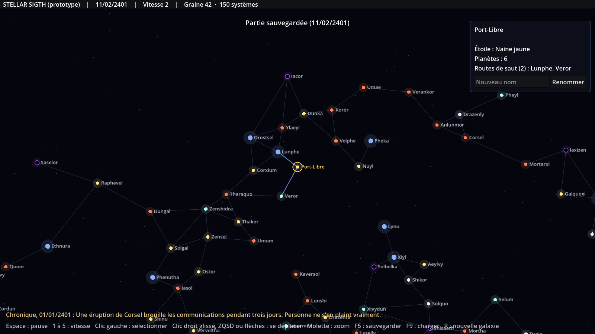

- **Un seul état, `GameState`.** Tout ce qui change en cours de partie y vit. La partie fixe de la galaxie (positions, routes) n'est pas sauvegardée : elle se régénère depuis la graine.
- **Déterministe.** Même état de départ + mêmes ordres aux mêmes ticks = même partie, à l'octet près. L'aléatoire de la simulation passe uniquement par `state.rng`, jamais par `randi()` global. `state.checksum()` donne une empreinte SHA-256 de l'état : en multijoueur, comparer les empreintes au même tick détectera les désynchronisations.
- **Les joueurs agissent par ordres.** Un ordre est un dictionnaire (`SimCommands.rename_system(...)`), soumis avec `Simulation.submit()`, revalidé puis appliqué à une frontière de tick. Pendant la pause, les ordres s'appliquent tout de suite sans faire passer le temps. Le journal `command_log` permet de rejouer une partie (`Simulation.replay`), base des rediffusions et de la reconnexion en multijoueur.
- **Le temps réel est à part.** `GameClock` transforme les secondes réelles en ticks et appelle `Simulation.step()`. Pause et vitesse sont des réglages locaux, pas de l'état de partie. En multijoueur, seul l'hôte pilotera l'horloge.
- **Sauvegarde JSON lisible** (`user://saves/quicksave.json`) avec version de format et empreinte vérifiée au chargement : un fichier abîmé ou modifié est refusé proprement. Écriture via un fichier temporaire pour ne jamais perdre la sauvegarde précédente.
- **Ajouter un système de jeu** (économie, flottes…) : un script dans `scripts/sim/systems/` avec une fonction `process(state)`, appelée dans `Simulation.step()` dans un ordre fixe.

## Économie et colonisation

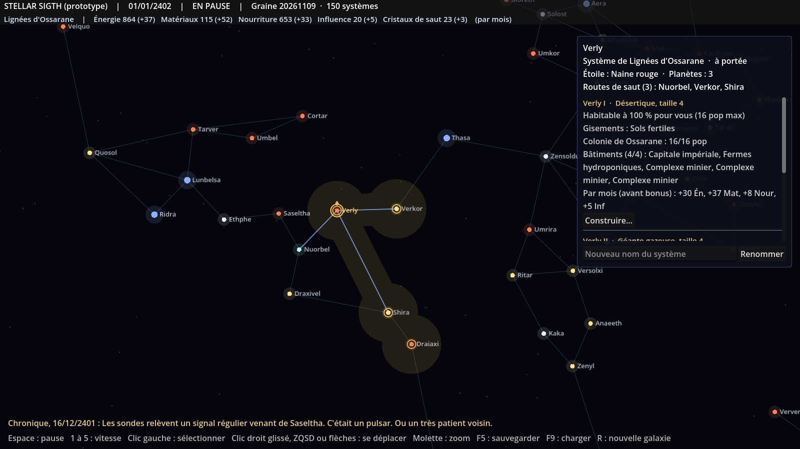

- **5 ressources** (périmètre V1 du GDD) : énergie, matériaux, nourriture, influence et cristaux de saut. Les stocks sont dans la barre du haut avec le solde du mois. Le bilan tombe tous les 30 jours.
- **Planètes générées depuis la graine** : 8 types (continentale, océanique, désertique, glaciaire, toxique, géante gazeuse, stérile, astéroïdes), une taille de 1 à 5 et parfois un gisement (filons riches, sols fertiles, géothermie, cristaux de saut, plus fréquents près des étoiles à neutrons et des trous noirs). Leur génération utilise son propre flux aléatoire : les galaxies existantes ne changent pas.
- **4 empires au départ**, un par faction, placés loin les uns des autres sur un monde d'origine à leur goût (8 pop, capitale, fermes, mine). Le joueur est l'empire 0 ; les trois autres vivent de leur économie en attendant l'IA.
- **Habitabilité selon l'espèce** : 100 % sur le type d'origine, 80 % sur le second préféré, sinon la valeur du type (une planète toxique n'accueille que l'Essaim Kh'thari). Population max = taille × 4 × habitabilité.
- **Colonie ou avant-poste** : une colonie (150 Mat, 40 Inf, 100 jours) accueille une population ; un avant-poste (60 Mat, 20 Inf, 45 jours) revendique le système et exploite n'importe quelle planète, et peut devenir une colonie plus tard. Il faut un vaisseau colon dans le système, ou une revendication déjà établie dans ce système (voir Flottes), au plus 2 fondations à la fois, et on ne s'installe pas dans le système d'un autre empire.
- **Population** : chaque pop produit selon le type de planète et mange 1 nourriture par mois. La croissance ralentit à mesure que la colonie grandit. En famine, la plus grosse colonie perd une pop et la croissance s'arrête ; en pénurie d'énergie, les chantiers s'arrêtent.
- **6 bâtiments** : fermes hydroponiques, centrale à fusion, complexe minier, forum impérial, raffinerie de cristaux (sur gisement, même sur un avant-poste) et habitats orbitaux (+4 pop max). Un chantier à la fois par planète, autant d'emplacements que sa taille.
- **Traits de faction** : Ossarane +50 % de cristaux (gisement garanti chez soi), Chœur Éternel +25 % de matériaux mais croissance -20 %, Vael +50 % d'influence et +10 % d'énergie, Kh'thari croissance ×2 mais +50 % de nourriture consommée et influence ÷2. Les mécaniques signatures (fiefs, ferveur, héros, biomasse) viendront avec l'étape des factions jouables.
- **Tout passe par des ordres** (`SimCommands.colonize`, `SimCommands.build`) et tout est calculé en nombres entiers, sans aléatoire : déterminisme, rediffusion et sauvegarde fonctionnent comme pour le reste du noyau. Le format de sauvegarde passe en version 2 ; les sauvegardes de la version 1 sont refusées avec un message clair.

## Tests

Un test de fumée vérifie la génération (plusieurs graines : 150 systèmes, galaxie connectée, noms uniques, déterminisme), le noyau de simulation (`tests/sim_tests.gd` : déterminisme sur 1000 ticks, ordres valides et refusés, ordres en pause, rediffusion, sauvegarde/chargement à l'identique, reprise après chargement identique à une partie jamais interrompue, fichiers abîmés refusés, performance), l'économie (`tests/economy_tests.gd` : données, planètes déterministes, départ des 4 empires, bilan mensuel exact, traits de faction, colonisation et chacun de ses refus, avant-poste transformé en colonie, chantiers et emplacements, croissance plafonnée, famine, pénurie d'énergie, déterminisme, rediffusion et sauvegarde avec colonies, 10 ans sans stock négatif), les empires IA (`tests/ai_tests.gd` : niveaux ordonnés, rivaux et spectateur, expansion en 2 ans sans famine, déterminisme et rediffusion, tour par tour identique au temps réel, aucune triche (brouillard, stocks), Recrue < Vétéran < Légende, talents de chaque peuple selon le niveau, tempérament (décalage du peuple, sauvegarde, belliqueux plus collé à ses rivaux que pacifique), sauvegarde, performance), la dernière information connue (`tests/intel_tests.gd` : mémoire dès le départ, système figé hors de vue puis rafraîchi au retour, date et âge du relevé, lecteur spectateur, sauvegarde 16 et reprise d'une sauvegarde 15, partage entre alliés, déterminisme, fiche de planète et carte, silhouettes de flottes (aperçue, gardée, effacée au retour ou après 90 jours, sauvegardée), vision des alliés en direct sans profit pour un tiers, IA qui juge sur sa mémoire : système pris en douce, force d'un rival, garnison estimée), les flottes (`tests/fleet_tests.gd` : flottes et vision de départ, chemins le long des routes, arrivée au jour annoncé, refus, demi-tour et arrêt en route, chantier spatial, colonisation par vaisseau colon, rassembler et détacher, entretien, premier contact, sauvegarde en plein trajet, rediffusion, expéditions d'exploration), le combat (`tests/combat_tests.gd` : règles de dégâts, déclaration de guerre, bataille et rapport, rapports de force, tactiques, déterminisme et sauvegarde en pleine bataille, blocus, retraite, siège et invasion, disparition d'un empire, traits de combat des 4 peuples, fusion et réparations, IA qui arme, déclare et se bat selon son tempérament et son niveau), le catalogue (`tests/catalogue_tests.gd` : classes de chaque peuple, conditions d'espèce d'une espèce personnalisée, arsenal et titan unique, torpilles, artillerie et défense ponctuelle, écran qui protège l'arrière, chasseurs qui le touchent, Martyr, tactique Adaptative, Coursier qui force le blocus, lancement du titan, IA qui se sert du catalogue, journal de bataille cohérent avec le rapport et identique après rechargement), la diplomatie (`tests/diplomacy_tests.gd` : statuts, propositions, refus, délais et expiration, trêve, alliance qui partage cartes et guerres, allié en paix qui reste en dehors, parjure, dénonciation, opinion (registres, credos, traits, souvenirs qui s'effacent), Essaim sans traité et espèce personnalisée, jugement de l'IA (guerre récente, guerre longue et perdue, tempérament, humeur de la Recrue, croisade), héritier soudoyé, banquet et trahison, arbitrage, ferveur, score de guerre, sauvegarde, partie entre IA déterministe où des traités se signent), les victoires (`tests/victory_tests.gd` : données, conquête et domination avec ou sans alliés, score à date limite, Élu, Couplet, Charte, Moisson, visibilité et menace, IA qui poursuit sa victoire, sauvegarde, déterminisme), la recherche (`tests/research_tests.gd` : arbre cohérent, arbre de chaque peuple (variantes, interdits, hérésies, peuple personnalisé), file et seuils d'ère, travail mis de côté, coûts (ère, technologies connues, taille de l'empire, talents des peuples), avancée mensuelle, effets sur l'économie, les flottes et le combat, contenu verrouillé, alliances et Chancelleries, ferveur et Exaltation, IA qui recherche selon son tempérament, déterminisme, sauvegarde), l'horloge et la scène principale avec des entrées simulées (pause, vitesse, clic, ouverture et fermeture de la vue système, bascule vers la vue de gestion, construction et colonisation depuis la fiche de la planète, renommage, F5/F9, Échap, brouillard, sélection de flotte, clic droit pour l'envoyer, fiche de flotte, F, chantier spatial), les bilans d'empire, l'interface (thème, barre d'empire, écrans Économie, Colonies, Recherche et Diplomatie (filtres, colonie choisie, anneau), pause automatique, Tab, H, flèches, fiche de sélection, lentille économique, cadran du temps, menu pause, menu principal et nouvelle partie avec faction et graine choisies, vue de replay ouverte depuis le rapport) ainsi que la géométrie de la vue système (planètes dans la scène et cliquables) :

```
godot --headless --path . -s res://tests/smoke_test.gd
```

Il affiche `OK : N vérifications passées.` et renvoie le code 0 si tout passe, 1 sinon.

## Limites connues

- Diplomatie V1 : ni vassalisation, ni conseil galactique, ni exigences ; les chiffres d'opinion et de jugement de l'IA sont à équilibrer en jouant. Les guerres contre l'Essaim ne finissent jamais (c'est voulu).
- Pas de conception modulaire des vaisseaux ni de contrôle pendant la bataille (la vue de replay ne fait que la rejouer ; conception modulaire prévue après la V1 dans le GDD), pas d'amiraux ni de héros (les héros de Vael attendent le système de personnages). Les classes du catalogue se débloquent par des technologies (et certaines par un bâtiment) ; l'éditeur de vaisseaux complet viendra avec ses modules.
- Les vaisseaux colons de l'IA ne tiennent pas encore compte des zones de guerre.
- Faute d'autre usage, les matériaux s'entassent chez les IA en milieu de partie ; l'Essaim Kh'thari, qui ne paie jamais d'influence, s'étend plus vite que les autres (équilibrage des peuples à revoir).
- Dernière information connue : l'IA juge encore la taille d'un rival (systèmes tenus) sur l'état réel quand elle pèse sa victoire.
- Pas encore de mécaniques signatures des factions : prochaine étape, les factions jouables.
- Équilibre des peuples bousculé par la recherche (contenu verrouillé, alliances qui attendent les Chancelleries) : sur trois parties d'essai de 9 ans entre IA Normal, Ossarane s'en sort plus mal qu'avant. À surveiller en jouant.
- Recherche, lot 1 : pas encore de marques d'armes IV-V, de doctrines, d'épaves, d'eurêkas ni de technologies ultimes ; les ères 4 et 5 sont presque vides. Les familles d'armes exclusives des peuples attendent l'éditeur de vaisseaux.
- Victoires : seuils calibrés sur quelques parties entre IA seulement. L'Essaim Kh'thari gagne souvent tôt par Conquête (an 9 sur la graine 42), ce qui tient à l'équilibre des peuples plus qu'aux victoires. Pas de victoire scientifique ni économique pour l'instant.
- Un seul emplacement de sauvegarde (rapide) pour l'instant ; l'écran de sauvegardes multiples viendra plus tard.
- Pas encore de sons d'interface ni de raccourcis personnalisables.
- Le multijoueur lui-même (réseau) n'est pas fait : le noyau est prêt pour un hôte qui fait autorité, mais rien n'est encore envoyé sur le réseau.
