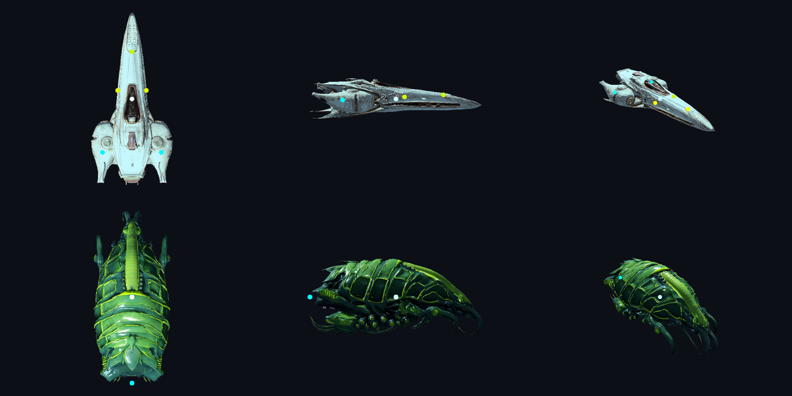
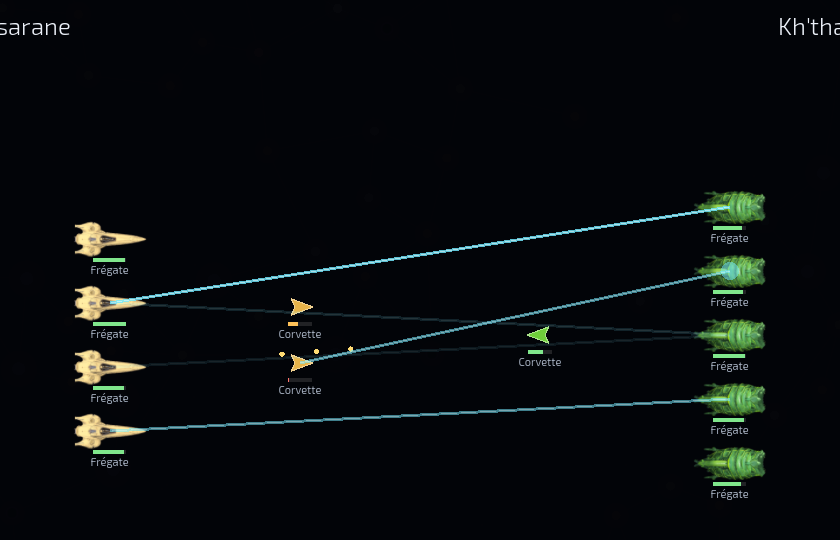

# Vaisseaux 3D : cahier des charges d'asset

Ce document fixe ce qu'un modèle de vaisseau doit respecter pour entrer dans Stellar Sigth, et comment
le produire. Il découle de l'étude « Vaisseaux 3D à partir d'images 2D » et du test Tripo du 2026-11-10
(scénario 2 retenu : Tripo pour la forme, Blender pour la cuisson).

Le modèle 3D (glTF) est la **source** de chaque vaisseau. Aujourd'hui le jeu est en 2D : on en tirera des
sprites avec carte de normales (lumières 2D de Godot). Plus tard, le même fichier servira à la vue 2.5D,
puis à un éventuel replay de bataille en 3D.

Les chiffres marqués *estimation* sont des points de départ, à ajuster une fois les vaisseaux vus en jeu.



## La chaîne en bref

| Étape | Outil | Qui | Sortie |
| --- | --- | --- | --- |
| 1. Concept | Midjourney | toi | une image 3/4 sur fond neutre (prompts dans l'étude) |
| 2. Version HD | Tripo Studio, modèle H3.1 | toi | `<nom>_hd.glb` |
| 3. Version basse | Tripo Studio, retopologie de la HD | toi | `<nom>_basse.fbx` |
| 4. Cuisson | `tools/vaisseaux/cuire_vaisseau.py` (Blender) | script | `<nom>.glb`, `<nom>_masque.png`, `<nom>.rapport.json` |
| 5. Contrôle | `tools/vaisseaux/apercu_vaisseau.gd` (Godot) | script, puis œil humain | planche dessus, profil, 3/4 |
| 6. Sprites | `tools/vaisseaux/sprites_vaisseau.gd` (Godot) | script | `<nom>_sprite.png`, `_sprite_masque.png`, `_sprite_n.png` dans `assets/ships/` |

### Réglages Tripo Studio

- **Génération** : image seule (la vue 3/4), modèle H3.1, texture et géométrie détaillées, PBR activé,
  « Supprimer l'éclairage » coché. Si la forme sort trapue ou ambiguë (vaisseau très long), refaire en
  multivue : profil en vue de face, profil retourné en vue de dos.
- **Retopologie** de cette même génération : quads, UV intelligentes, nombre de faces selon la taille
  (tableau plus bas). La version basse et la HD sortent ainsi déjà alignées.
- **Exports** : la HD en glb, la version basse en FBX (imposé par les quads).
- Tripo produit la texture de la version basse, mais on ne la garde pas : la cuisson Blender depuis la HD
  est nettement plus nette de près (test du 2026-11-10).

## Nommage

`<nom>` = `<peuple>_<coque>`, plus `_<variante>` si besoin, en minuscules, sans accents :

- `<peuple>` : l'`id` de `data/factions.json` (`ossarane`, `choeur`, `vael`, `khthari`), ou `commun` pour
  un modèle partagé par les peuples personnalisés (*proposition*).
- `<coque>` : la clé de la coque dans `data/designs.json` (`fregate`, `croiseur`, `titan_bastion`…).
- Exemples : `ossarane_fregate`, `khthari_ruche_mere`, `vael_croiseur_2`.

Emplacements :

- `sources/` à la racine, ignoré par git et par Godot (`.gdignore`, posé par le script de cuisson) :
  les exports Tripo (`<nom>_hd.glb`, `<nom>_basse.fbx`, 60 à 70 Mo pour une HD), `<nom>.points.json`,
  et les sorties de la cuisson (`<nom>.glb`, son masque, son rapport). C'est la source 3D de chaque
  vaisseau : à sauvegarder ailleurs que dans le dépôt.
- `assets/ships/` : les sprites, seuls fichiers que le jeu charge pour l'instant (quelques centaines de
  Ko par vaisseau, versionnés).

## Axes, échelle, origine

- **L'avant pointe vers -Z de Godot**, le dessus vers +Y. Dans Blender : nez vers +Y, dessus vers +Z.
- Origine au centre de la boîte englobante.
- La plus grande dimension horizontale vaut la longueur de la taille de coque (*estimation*) :

| Taille (`size`) | Longueur (unités Godot) | Faces Tripo (quads) | Triangles visés | Cartes |
| --- | --- | --- | --- | --- |
| `small` | 1,0 | 2 000 | 1 500 à 5 000 | 1024 |
| `medium` | 1,6 | 6 000 | 5 000 à 15 000 | 2048 |
| `large` | 2,5 | 10 000 (maximum Tripo en quads) | 15 000 à 40 000 | 2048 |
| `titan` | 5,0 | par pièce | 40 000 à 100 000 | 4096 |

Tripo plafonne à 10 000 quads ou 20 000 triangles par modèle. Les titans et plus devront être générés en
pièces (coque, modules) assemblées dans Blender : à préciser au premier titan.

Le script ne devine pas où est le nez : s'il ressort à l'envers sur la planche de contrôle, relancer avec
`--tourner 180` (ou `90`, `-90`).

## Cartes

Toutes cuites depuis la HD sur de nouvelles UV, et embarquées dans le `.glb` :

- **Couleur** (sRGB).
- **Normales** en espace tangent, convention OpenGL (+Y), celle qu'attend Godot.
- **ORM** : R = occlusion ambiante, G = rugosité, B = métal. Godot la lit directement.

Pas encore de carte d'émission : les lumières (réacteurs, hublots) seront ajoutées par effets sur les
points `fx_`, ou plus tard par une carte peinte.

## Masque de couleur d'empire

`<nom>_masque.png`, sur les mêmes UV que la couleur : blanc = zone peinte aux couleurs de l'empire,
noir = matière d'origine. Le jeu teintera la couleur par la couleur de l'empire là où le masque est blanc.

Le script en fait un premier jet automatique : la teinte dominante de la coque devient la zone peinte.
Le rapport indique la part peinte. Si elle est trop large ou trop étroite, relancer avec
`--masque-tolerance` (0,18 par défaut, plus petit = zone plus étroite ; 0,10 pour la frégate Kh'thari)
ou retoucher le PNG à la main.

## Points d'attache

Des nœuds vides nommés, enfants du maillage, que le jeu lira pour placer tirs, effets et modules :

| Nom | Rôle |
| --- | --- |
| `centre` | centre du vaisseau (boucliers, explosions) |
| `fx_reacteur_<n>` | sortie de chaque réacteur, de 1 à n |
| `slot_<type>_<n>` | emplacement de module, `<type>` parmi les `slot_types` de `data/designs.json` (`weapon`, `heavy`, `defense`, `support`, `titanic`, `colossal`, `astral`) |

Un nom qui ne commence ni par `slot_`, ni par `fx_`, ni par `centre` est ignoré, avec un avertissement.
Pour l'instant, le nombre de `slot_` n'a pas à correspondre aux emplacements de la coque : le jeu ne les
utilise pas encore.

Ils se décrivent dans `<nom>.points.json`, en fractions de la boîte du vaisseau : x de -1 (gauche) à 1
(droite), y de -1 (arrière) à 1 (nez), z de -1 (dessous) à 1 (dessus).

```json
{
	"centre": [0, 0, 0],
	"fx_reacteur_1": [-0.72, -0.62, -0.05],
	"fx_reacteur_2": [0.72, -0.62, -0.05],
	"slot_weapon_1": [0, 0.55, 0.2]
}
```

Sans fichier, le script pose `centre` et un `fx_reacteur_1` au milieu de l'arrière.

## Outils

Blender 4.2 LTS ou plus récent (testé avec 4.5.3 LTS), sans interface. Godot 4.7 pour la planche.

```sh
blender -b --python tools/vaisseaux/cuire_vaisseau.py -- \
    --hd sources/ossarane_fregate_hd.glb --basse sources/ossarane_fregate_basse.fbx \
    --nom ossarane_fregate --taille medium --points sources/ossarane_fregate.points.json

godot --path . -s res://tools/vaisseaux/apercu_vaisseau.gd -- \
    sources/ossarane_fregate.glb ossarane_fregate_planche.png

godot --path . -s res://tools/vaisseaux/sprites_vaisseau.gd -- sources/ossarane_fregate.glb
```

Options de la cuisson : `--sortie` (défaut `sources`), `--tourner`, `--resolution`,
`--masque-tolerance`, `--sans-masque`. Compter 1 à 2 minutes par frégate sur 4 cœurs, l'occlusion
ambiante prenant l'essentiel.

Le rapport `<nom>.rapport.json` donne les triangles, le budget, les dimensions, les points posés et la
part du masque, avec des avertissements si le budget est dépassé ou si la version basse a dû être recalée
sur la HD (signe qu'elles ne viennent pas de la même génération).

## Contrôle avant de valider un vaisseau

1. Sur la planche : nez en haut dans la vue de dessus, à droite dans le profil.
2. Pas de trou ni de pointe aberrante sur la silhouette.
3. Points d'attache aux bons endroits (jaune = `slot_`, cyan = `fx_`, blanc = `centre`).
4. Zone teintée en bleu = celle qui prendra la couleur de l'empire : elle doit couvrir la coque,
   pas le cockpit ni les réacteurs.
5. Rapport sans avertissement.

## Sprites et affichage en jeu

`sprites_vaisseau.gd` photographie le modèle vu de dessus, nez vers la droite, fond transparent,
512 pixels pour la longueur (3e argument pour changer) :

- `<nom>_sprite.png` : rendu éclairé (soleil venu de l'avant gauche), ce que le jeu affiche ;
- `<nom>_sprite_masque.png` : le masque d'empire vu sous le même angle ;
- `<nom>_sprite_n.png` : les normales vues de dessus (x à droite, y en haut), réservées à de futures
  lumières 2D.

Le jeu (`scripts/ui/ship_art.gd`) cherche `assets/ships/<peuple>_<coque>_sprite.png` pour chaque vaisseau :
la coque d'une classe vient de `origin` dans `data/designs.json` (une bombarde est une coque de frégate),
celle d'un modèle conçu de son enregistrement, et une variante de coque se rabat sur sa coque de base.
La zone du masque est teinte à 55 % vers la couleur de l'empire, en gardant la luminosité du sprite.
Sans sprite, l'interface garde son dessin stylisé : on peut donc ajouter les vaisseaux un par un.

Pour l'instant, les sprites apparaissent dans la vue de replay des batailles (retournés pour le camp de
droite, grisés une fois détruits) et en filigrane derrière les emplacements du Chantier.



## Pas encore fait

- Les sprites sur la carte galactique et dans la vue système (les flottes y sont des icônes).
- Les lumières 2D qui utiliseraient les normales des sprites.
- Les titans en pièces assemblées.
